<p align="center">
  
</p>

<h3 align="center">Vos films, vos séries et votre musique Plex, Jellyfin ou Emby, dans une application rapide et soignée.</h3>

<p align="center">
  
  
  
  
  
  
  
  
  <a href="LICENSE"></a>
  <a href="https://ko-fi.com/yanutros"></a>
</p>

<p align="center">
  <a href="#-ce-que-fait-maku">Fonctionnalités</a> ·
  <a href="#-aperçu">Aperçu</a> ·
  <a href="#-installer">Installer</a> ·
  <a href="#%EF%B8%8F-configurer">Configurer</a> ·
  <a href="#-développer">Développer</a> ·
  <a href="#-confidentialité">Confidentialité</a> ·
  <a href="#-signature-du-code">Code signing policy</a> ·
  <a href="#%EF%B8%8F-mentions-légales">Mentions légales</a> ·
  <a href="#-soutenir-maku">Soutenir</a> ·
  <a href="#-licence">Licence</a>
</p>

---

Maku (anciennement **Plexr**) est un client [Plex](https://www.plex.tv), [Jellyfin](https://jellyfin.org) et [Emby](https://emby.media) pour PC,
écrit en Rust avec [Tauri](https://tauri.app). Son nom vient de 幕, « rideau » en japonais : celui qui s'ouvre sur la
séance ; son logo, un soleil couchant rayé, prend la couleur choisie dans l'interface. La vidéo
et la musique sont lues par [mpv](https://mpv.io), directement dans la fenêtre de l'application, et l'interface est
pensée comme celle d'une box TV : grands visuels, bandeaux qui défilent, rien de superflu.

Il existe aussi en **application Android**, pour les **téléphones**, les **tablettes** et **Android TV / Google TV** :
une interface tactile façon application mobile sur téléphone, et une interface dédiée à la télécommande, plus
légère, pour rester fluide sur le matériel limité des téléviseurs.

Il réunit aussi deux outils que l'on utilise souvent à côté de Plex : **Seerr** (Jellyseerr / Overseerr), pour
demander un film ou une série absent de la bibliothèque, et **Tracearr**, pour suivre ses statistiques de
visionnage. Tout se fait avec son compte Plex (ou Jellyfin) : aucune clé d'API à saisir.

## ✨ Ce que fait Maku

<table>
  <tr>
    <td width="50%" valign="top">
      <h4>🎬 Il lit tout, dans sa propre fenêtre</h4>
      Vidéo intégrée, qui s'ouvre sur un fond noir jusqu'à sa première image, avec des commandes façon Apple TV : une capsule translucide qui flotte en bas de l'image
      (titre, pistes audio et sous-titres en cours, progression, temps restant, ±10 s, épisode précédent et
      suivant, arrêt), retour, volume et plein écran en boutons ronds dans les coins, raccourcis clavier. Reprise là où
      vous vous étiez arrêté. Qualité au choix, comme dans Plex : le fichier d'origine, ou une conversion par le
      serveur de 20 Mb/s en 1080p à 1,5 Mb/s en 480p, retenue pour les vidéos suivantes et visible telle quelle
      dans Tautulli et Tracearr. Un film en plusieurs versions (4K, 1080p…) se choisit sur sa fiche, avec ses
      propres pistes audio et sous-titres. Au survol de la barre de progression, la miniature de l'instant visé
      apparaît, quand le serveur a généré les aperçus (Plex) ou le « trickplay » (Jellyfin).
    </td>
    <td width="50%" valign="top">
      <h4>🏠 Il met vos bibliothèques en valeur</h4>
      Accueil et bibliothèques avec un bandeau qui fait défiler cinq titres, puis un « Continuer à regarder »
      façon plateforme de streaming : grandes affiches, et celle survolée s'ouvre en grand avec sa scène, son
      épisode, sa progression et le bouton Reprendre ; un clic sur la carte ouvre la fiche. Puis de grands panneaux « À la une » et les rangées de Plex. Au survol d'une affiche, un simple triangle blanc lance la lecture.
      L'accueil se personnalise (Réglages → Interface, ou le bouton en bas de l'accueil) : rangées à masquer ou à
      réordonner, et bibliothèques à épingler avec leurs derniers ajouts, pour chaque appareil.
      La fiche d'un film ou d'une série plonge dans son ambiance, comme Jellyfin : son fond en haute définition
      sur toute la largeur (celui de la saison pour une série), le logo en grand et centré avec le titre
      d'origine, la note et l'heure de fin, le résumé dessous, puis deux panneaux — l'équipe d'un côté, la
      vidéo, l'audio et les sous-titres de l'autre — la distribution et « Plus de ce genre ».
      Les titres s'affichent avec leur logo officiel, comme dans Jellyfin : celui du serveur, sinon celui du
      service en ligne de Plex — un logo dans la langue de l'interface passe avant celui du serveur, souvent en anglais —, et en dernier recours de TMDB avec votre clé d'API gratuite (Réglages → Services ; sur téléviseur, un QR code permet de la coller depuis le téléphone) ; les épisodes et les saisons reprennent celui de leur série ; sans logo nulle part, une typographie de cinéma choisie selon le genre. La musique, elle, garde ses titres en texte simple.
    </td>
  </tr>
  <tr>
    <td valign="top">
      <h4>🗂️ Il range par catégories</h4>
      Chaque genre devient une grande carte colorée avec un éventail des affiches les mieux notées. Un clic
      filtre la bibliothèque.
      Les bibliothèques de films ont aussi leurs **collections** (sagas, univers…) : chacune ouvre sa page, avec
      ses films dans l'ordre de sortie et un bouton qui lance le premier pas encore vu.
    </td>
    <td valign="top">
      <h4>🎵 Il joue votre musique</h4>
      Une page d'accueil façon Apple Music : grands panneaux des derniers albums, playlists (la dernière lue en premier),
      « Titres du moment », pochettes qui grandissent avec la fenêtre. File d'attente, lecture aléatoire et
      vue « En cours de lecture », dont le fond aux couleurs de la pochette passe jusque derrière le menu, avec les
      paroles synchronisées à côté de la pochette (lrclib.net, gratuit ; la ligne chantée ressort, un clic y saute,
      désactivable dans Réglages → Lecteur). **Radio** sur la fiche d'un artiste : ses titres mêlés à ceux
      d'artistes proches, choisis par le serveur (station de Plex, mix instantané de Jellyfin et Emby). Les titres
      s'enchaînent sans blanc : le suivant est chargé pendant la fin du précédent. Une barre
      de lecture flottante, en verre dépoli teinté par la pochette, reste en bas du contenu pendant que vous naviguez,
      avec des commandes toutes de même taille.
    </td>
  </tr>
  <tr>
    <td valign="top">
      <h4>📥 Il fait vos demandes</h4>
      Découvrez les tendances et les sorties à venir via Seerr, lisez la fiche complète (notes, casting,
      bande-annonce) et demandez un film ou des saisons en un clic.
    </td>
    <td valign="top">
      <h4>📊 Il raconte vos habitudes</h4>
      Avec Tracearr : temps passé devant l'écran, top 10 du mois, plus long marathon, genres préférés… dans
      une page façon Apple TV, sur un fond aux couleurs de votre titre le plus regardé qui couvre toute la fenêtre, menu compris.
    </td>
  </tr>
  <tr>
    <td valign="top">
      <h4>🔍 Il trouve tout</h4>
      Une seule recherche pour les films, séries et artistes de la bibliothèque, puis les titres absents
      que l'on peut demander. Un acteur, sur une fiche, ouvre tous ses films et séries du serveur.
    </td>
    <td valign="top">
      <h4>🔑 Il se connecte avec Plex</h4>
      Connexion par code PIN, choix du serveur avec test automatique des adresses (revérifiées au retour dans l'application et à chaque changement de réseau, Wi-Fi ↔ données mobiles) ; Seerr et Tracearr
      utilisent le même compte. Avec Plex Home, « Qui regarde ? » au lancement : profils, profils gérés et
      code PIN, comme dans Plex, ou connexion automatique au dernier profil (Réglages → Compte) ; la carte du
      profil, en bas du menu, change d'utilisateur à tout moment.
    </td>
  </tr>
  <tr>
    <td valign="top">
      <h4>✏️ Il modifie vos fiches</h4>
      Titre, résumé, dates, genres, affiche et fond d'écran d'un film, d'une série ou d'un album, avec les
      verrous de champ de Plex. Menu ⋮ (ou clic droit) sur chaque jaquette. « Ajouter à la collection… » range un
      film ou une série dans une collection de sa bibliothèque, ou en crée une nouvelle, comme dans Plex.
    </td>
    <td valign="top">
      <h4>🛠️ Il administre le serveur</h4>
      Lectures en cours, entretien des bibliothèques, utilisateurs (bibliothèques partagées, téléchargements,
      invitation, retrait) et réglages du serveur (général, réseau, transcodeur…),
      pour l'administrateur uniquement : le propriétaire du serveur selon plex.tv (pas les membres du Plex Home
      ni les amis), et chaque action le vérifie.
    </td>
  </tr>
  <tr>
    <td valign="top">
      <h4>🎨 Il prend vos couleurs</h4>
      Quatre couleurs au choix (jaune, rouge, vert, violet) dans Réglages → Interface ; l'icône de l'application
      suit, dans la barre des tâches comme sur l'écran d'accueil d'Android et de la TV.
    </td>
    <td valign="top">
      <h4>🌍 Il parle votre langue</h4>
      Français, anglais, espagnol, allemand et néerlandais : Maku suit la langue du système, ou celle choisie dans
      Réglages → Interface. Les fiches Seerr et les rangées de Plex arrivent dans la même langue.
    </td>
  </tr>
  <tr>
    <td valign="top">
      <h4>🔄 Il se met à jour tout seul</h4>
      Au lancement, une fenêtre présente la nouvelle version, ses nouveautés et ses corrections (dans la langue
      de l'interface ; Réglages → Compte les rappelle pour la version installée) ; un clic télécharge et installe
      le bon paquet, y compris sur Android TV, où installer à la main est fastidieux.
    </td>
    <td valign="top">
      <h4>📨 Il s'invite en un QR code</h4>
      L'administrateur partage un QR code ; chez l'utilisateur, il remplit Seerr et Tracearr et lance la
      connexion. Sur la télé, on le montre simplement à son téléphone.
    </td>
  </tr>
  <tr>
    <td valign="top">
      <h4>📺 Il passe sur la télé</h4>
      Sur Android TV, une interface faite pour la télécommande, à la manière des applications TV : la fiche de
      l'élément sélectionné en haut, des rangées de jaquettes en dessous, un menu qui se déplie quand on y entre.
      Dans la musique et les statistiques, la page prend les couleurs floutées de la pochette sélectionnée, jusque
      derrière le menu.
      Connexion par un code à saisir sur plex.tv/link depuis son téléphone.
    </td>
    <td valign="top">
      <h4>📱 Il tient dans la main</h4>
      Sur téléphone, une interface mobile : onglets en bas, bandeau et « Continuer à regarder » à la taille de
      l'écran, mini-lecteur façon Spotify et musique pilotable depuis la notification, même Maku fermé.
      En voiture, la bibliothèque musicale se parcourt et se lit depuis l'écran d'Android Auto.
      Sur tablette, l'interface de l'ordinateur adaptée au toucher.
    </td>
  </tr>
</table>

## 📸 Aperçu

> [!NOTE]
> Ces captures viennent du **mode démo** de Maku : la bibliothèque est fictive et toutes les affiches sont
> générées par le programme. Aucun film, aucune série ni aucune œuvre réelle n'y figure.

<p align="center">
  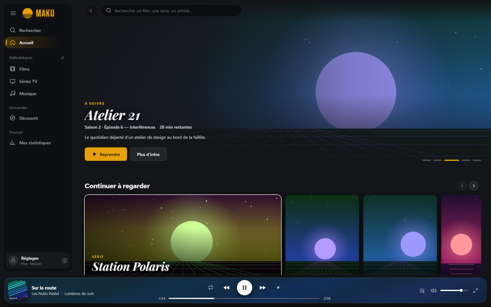
  <br /><em>L'accueil : bandeau « À suivre », rangées et barre de musique.</em>
</p>

<table>
  <tr>
    <td width="50%">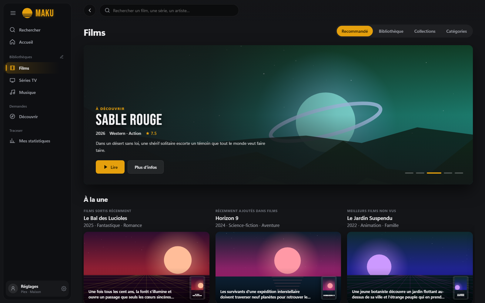<br /><em>🎞️ Une bibliothèque, onglet Recommandé</em></td>
    <td width="50%">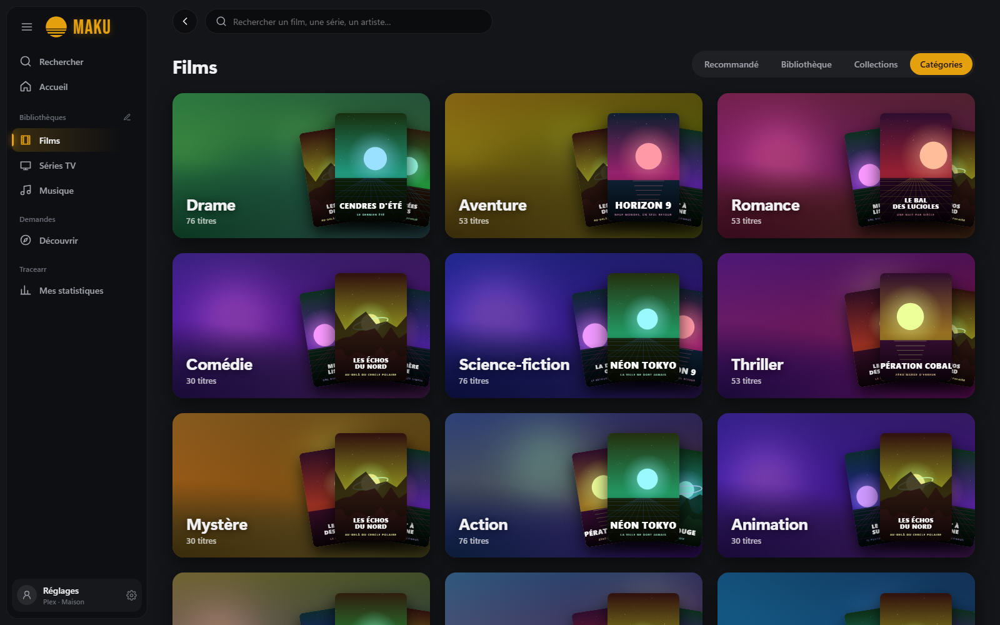<br /><em>🗂️ Les catégories</em></td>
  </tr>
  <tr>
    <td>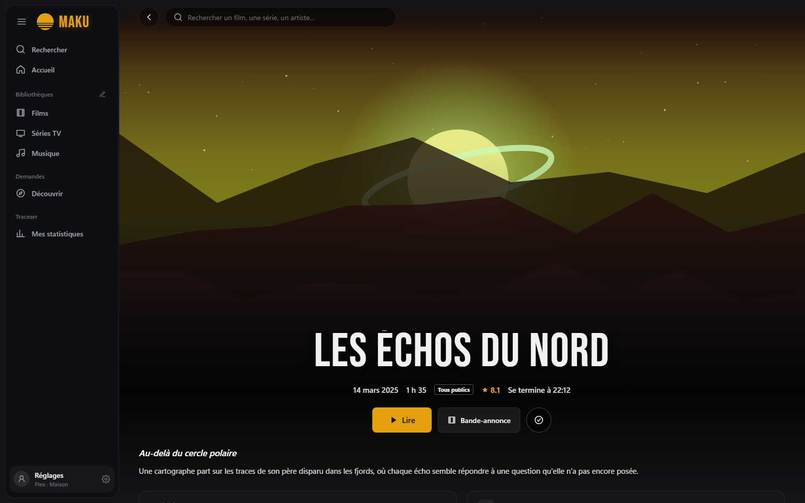<br /><em>📄 La fiche d'un film</em></td>
    <td>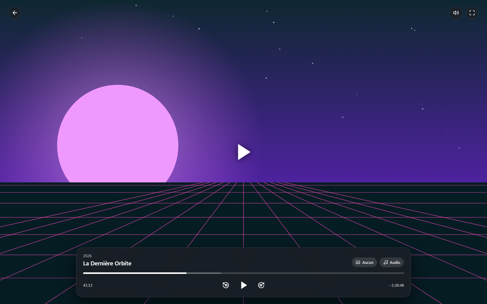<br /><em>▶️ Le lecteur intégré</em></td>
  </tr>
  <tr>
    <td>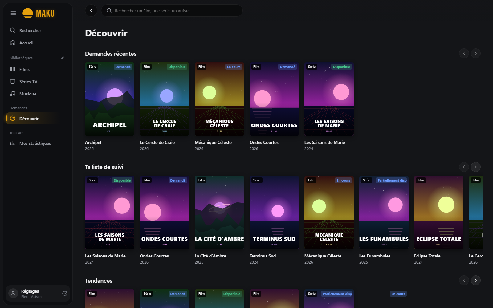<br /><em>🧭 Découvrir avec Seerr</em></td>
    <td>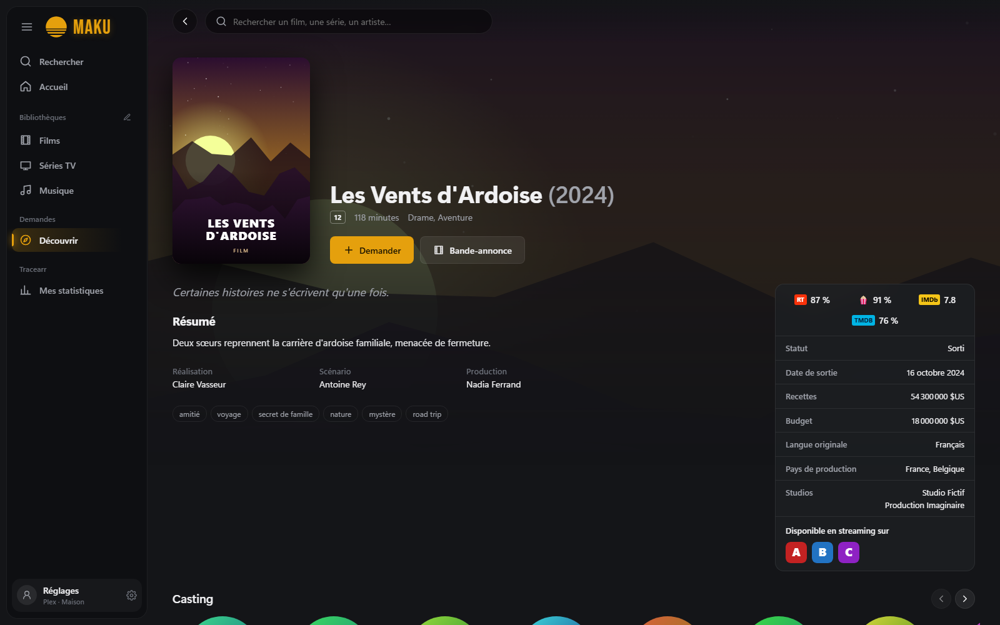<br /><em>📥 Demander un titre</em></td>
  </tr>
  <tr>
    <td>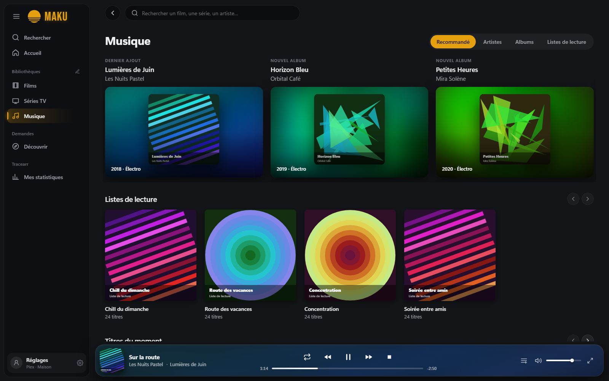<br /><em>🎵 La musique</em></td>
    <td>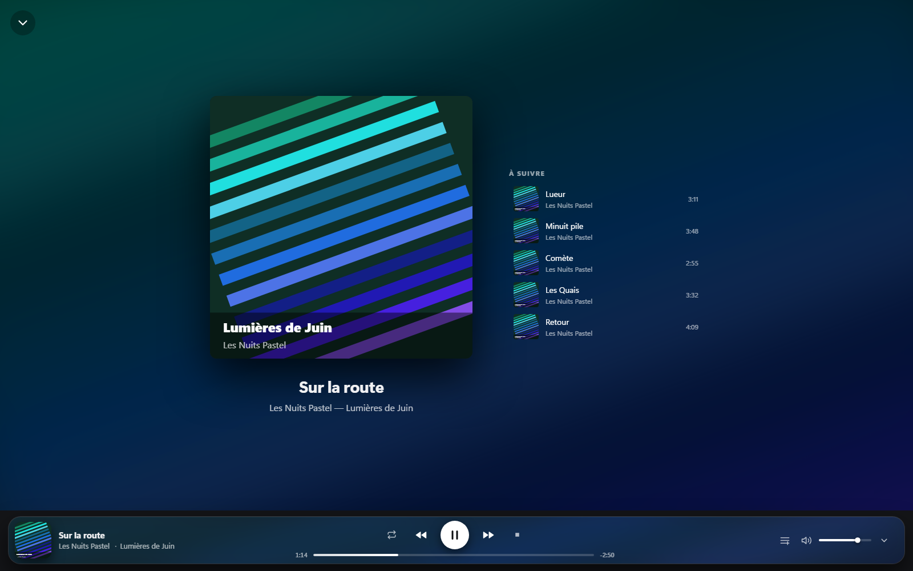<br /><em>🎧 En cours de lecture</em></td>
  </tr>
  <tr>
    <td>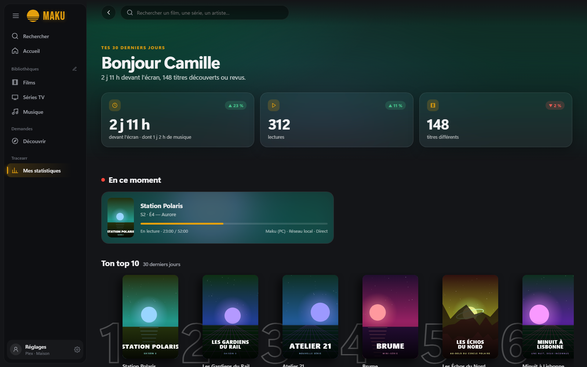<br /><em>📊 Mes statistiques (Tracearr)</em></td>
    <td>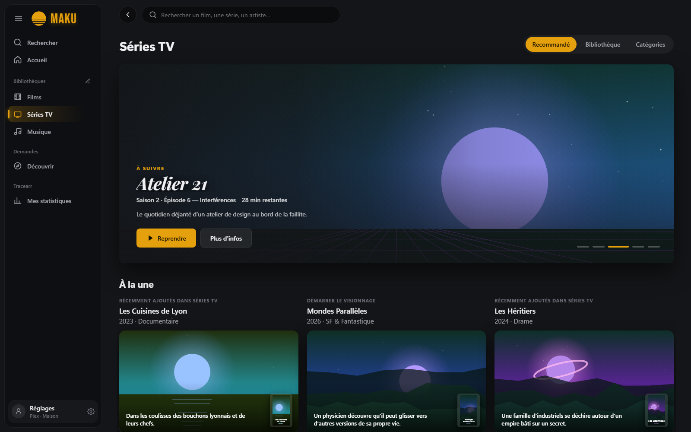<br /><em>📺 Les séries</em></td>
  </tr>
</table>

## 🧰 Ce qu'il faut

<table>
  <tr><td>💻 <b>Système</b></td><td>Windows 10 ou 11, Linux (Fedora, Debian, Ubuntu… en 64 bits), macOS 11 et plus, ou Android 7 et plus (téléphones, tablettes, Android TV, Google TV ; processeurs ARM)</td></tr>
  <tr><td>🎞️ <b>Plex</b></td><td>un compte Plex et l'accès à un serveur Plex Media Server</td></tr>
  <tr><td>▶️ <b>mpv</b></td><td>sur ordinateur, le lecteur <a href="https://mpv.io">mpv</a> : fourni avec l'installeur Windows, installé automatiquement avec les paquets RPM et DEB, sinon voir ci-dessous (inutile sur Android)</td></tr>
  <tr><td>➕ <b>En option</b></td><td>une instance <a href="https://github.com/seerr-team/seerr">Seerr / Jellyseerr / Overseerr</a> pour les demandes, une instance <a href="https://github.com/connorgallopo/Tracearr">Tracearr</a> pour les statistiques</td></tr>
</table>

## 🚀 Installer

Les paquets de chaque version sont publiés dans les [Releases](../../releases) du dépôt.

| Système | Fichier | Installation |
| --- | --- | --- |
| 🪟 **Windows** | `Maku_<version>_x64-setup.exe` (ou `.msi`) | lancez l'installeur : mpv est inclus, rien d'autre à installer (voir aussi [Signature du code](#-signature-du-code)) |
| 🎩 **Fedora / RHEL** | `Maku-<version>-1.x86_64.rpm` | `sudo dnf install ./Maku-*.rpm` (installe aussi mpv) |
| 🐧 **Debian / Ubuntu** | `Maku_<version>_amd64.deb` | `sudo apt install ./Maku_*.deb` (installe aussi mpv) |
| 📦 **Autres Linux** | `Maku_<version>_amd64.AppImage` | rendez-le exécutable (`chmod +x`), installez mpv avec votre gestionnaire de paquets |
| 🍎 **macOS** | `Maku_<version>_universal.dmg` | glissez Maku dans Applications, puis `brew install mpv` |
| 🤖 **Android (téléphone, tablette, TV)** | `Maku_<version>_android.apk` | voir ci-dessous |

Maku s'ouvre ensuite comme n'importe quel logiciel (menu Démarrer, lanceur d'applications ou Launchpad).

> [!NOTE]
> **Sous Linux et macOS**, la vidéo s'ouvre dans une fenêtre mpv séparée, en plein écran : Maku la pilote à
> distance (pause, avance, pistes…) et suit la progression comme sous Windows. L'incrustation de la vidéo dans la
> fenêtre de Maku n'existe pour l'instant que sous Windows. La musique fonctionne partout de la même façon.

> [!IMPORTANT]
> **Fedora** : le mpv des dépôts Fedora s'appuie sur `ffmpeg-free`, qui ne sait décoder ni le H.264, ni le HEVC,
> ni l'E-AC3 : la plupart des films s'arrêtent dès l'ouverture. Installez le FFmpeg complet de
> [RPM Fusion](https://rpmfusion.org/Configuration) (dépôts « free » activés) :
> `sudo dnf swap ffmpeg-free ffmpeg --allowerasing`.

> [!IMPORTANT]
> **macOS** : l'application n'est pas signée par Apple. Au premier lancement, faites un clic droit sur Maku →
> **Ouvrir**, puis confirmez.

### 📱 Android : téléphones, tablettes et TV

L'APK s'installe à la main (« sideload »), une seule fois — les versions suivantes s'installent depuis Maku
(voir *Mises à jour*). Une version **Google Play**, « Maku Player », est en test fermé : celle-là est mise à jour par
le Play Store.

- **Téléphone et tablette** : copiez l'APK sur l'appareil et ouvrez-le ; Android demande d'autoriser
  l'installation depuis le gestionnaire de fichiers ou le navigateur.
- **Téléviseur** : le plus simple est l'application *Downloader* (ou un gestionnaire de fichiers avec une clé
  USB). Depuis un ordinateur, avec le débogage activé dans les options pour les développeurs de la TV :
  `adb connect <ip-de-la-tv>:5555` puis `adb install Maku_<version>_android.apk`.

Maku apparaît ensuite parmi les applications, avec sa bannière sur l'écran d'accueil de la TV.

Sous **Android 17**, Maku demande au premier lancement l'autorisation d'accéder aux appareils du réseau local :
sans elle, un serveur sur le réseau de la maison (Jellyfin, ou Plex par son adresse locale) reste injoignable.

**Sur téléphone**, l'interface prend la forme d'une application mobile : un en-tête compact sous la barre
d'état, des onglets en bas (Accueil, Bibliothèques, Découvrir, Stats, Réglages), le bandeau et « Continuer à
regarder » à la taille de l'écran, des fiches qui s'empilent. Un appui long sur une affiche ouvre son menu ; dans
les bandes d'onglets, l'onglet touché se centre. Les vidéos passent en paysage et en plein écran.

**Musique en arrière-plan** : sur téléphone comme sur tablette, la musique continue quand Maku est quitté, avec
une notification (pochette, titre, précédent / lecture / suivant, progression) qui la pilote aussi depuis l'écran
de verrouillage et les boutons d'un casque Bluetooth. Fermer Maku depuis les applications récentes l'arrête.
Le mini-lecteur, façon Spotify (lecture, suivant et arrêt), ouvre en plein écran la pochette, la progression et toutes les commandes, arrêt compris ; comme sur ordinateur, le bouton lecture a la taille des autres.

**Android Auto** : Maku apparaît parmi les applications de musique de la voiture, avec quatre onglets —
**Accueil** (ajouts récents), **Artistes** (avec une lecture aléatoire de toute la bibliothèque), **Albums** et
**Playlists** — illustrés de leurs pochettes (la photo de l'artiste quand un album n'en a pas, comme dans l'application). Un album ou une playlist se lit d'un coup ou à partir d'un morceau,
avec la file d'attente à l'écran ; « Joue … sur Maku » lance un artiste, un album ou un morceau à la voix. La
voiture lit elle-même la musique (ExoPlayer), même si Maku n'est pas ouvert sur le téléphone : le compte et le
serveur viennent de la configuration de Maku, et hors du Wi-Fi l'adresse distante du serveur (ou le relais Plex)
prend le relais. Les écoutes remontent dans l'historique de Plex. Une musique lancée sur le téléphone remplace
celle de la voiture, et inversement.

> [!IMPORTANT]
> Tant que Maku n'est pas sur le Play Store, Android Auto ne montre pas dans la voiture une application
> installée à la main. Sur le téléphone : Android Auto → **Paramètres** → touchez dix fois **Version** pour
> ouvrir les **Paramètres développeur** → activez **Sources inconnues**. Maku apparaît alors dans le lanceur de
> la voiture (et dans **Personnaliser le lanceur**, si elle y est décochée). Sans ce réglage, toucher la musique
> de Maku dans la voiture ouvre seulement l'application sur le téléphone.

En cas de problème en voiture, la voiture affiche la cause (serveur à choisir,
téléphone à déverrouiller une première fois, compte Plex absent, serveur injoignable). Android Auto ne connaît
pour l'instant que Plex.

> [!NOTE]
> **Lecture sur Android** : il n'y a pas de mpv. La vidéo est lue par ExoPlayer, le lecteur natif qu'utilisent
> aussi Plex et Wholphin : le fichier d'origine (4K, HEVC, HDR compris) est décodé par l'appareil et affiché dans
> sa propre couche, sous l'interface de lecture de Maku — fluide même sur un téléviseur modeste, au bon format
> (bandes noires pour un film plus large que l'écran). Les pistes audio
> et les sous-titres (intégrés ou externes) se choisissent pendant la lecture. Comme Moonfin, Maku convertit le
> moins possible : les sons que l'appareil ne décode pas (DTS, DTS-HD, TrueHD) le sont par FFmpeg, et le son
> Dolby, DTS ou Atmos part tel quel vers l'ampli ou la barre de son qui l'accepte (**Réglages → Lecteur** :
> Automatique, ou « Décodé ici » si un film reste muet ; la page montre les formats acceptés). La dernière
> détection valable de la sortie audio est gardée pour le démarrage à froid, quand la liaison HDMI n'est pas encore
> établie. Si seul le son reste illisible, le serveur (Plex, Jellyfin ou Emby) copie la vidéo d'origine et ne
> convertit que le son ; sinon, il convertit tout à la volée (HLS, 1080p). La musique est lue directement. La reprise,
> l'épisode suivant et la progression fonctionnent comme sur ordinateur.
>
> **Lecture hors ligne** (téléphone et tablette Android) : sur la fiche d'un film, d'un épisode ou d'une saison,
> **Télécharger** garde le titre sur l'appareil, dans le fichier d'origine (toutes ses pistes) ou converti par le
> serveur en 1080p ou 720p, plus léger ; un album ou une playlist se télécharge aussi, titre par titre. La page
> **Téléchargements** (Bibliothèques sur téléphone, menu sur tablette) les regroupe, avec leur avancement, et les lit
> sans réseau ; sans connexion, l'accueil y mène. Une coupure reprend là où elle s'était arrêtée. La progression
> jouée hors ligne est renvoyée au serveur dès qu'il répond. Le téléchargement n'apparaît que pour les comptes
> qui en ont le droit : « Autoriser les téléchargements » de Plex, réglé par l'administrateur pour chaque ami, ou
> « Autoriser le téléchargement de médias » de Jellyfin et d'Emby.
>
> **Journal de diagnostic** (**Réglages → Lecteur**) : si l'appareil se bloque pendant une vidéo ou qu'une lecture
> échoue, Maku garde la trace de l'appareil (modèle, puce, mémoire, écran), de chaque lecture (fichier d'origine ou
> conversion, décodeurs choisis, format de l'image et du son, images perdues), des erreurs et de la mémoire libre
> toutes les 30 secondes pendant une vidéo. Chaque ligne est écrite aussitôt, si bien que celles qui précèdent un
> blocage survivent au redémarrage, et une lecture interrompue est signalée au lancement suivant. Sur téléphone, le
> journal se partage ; sur TV, un QR code le fait télécharger par le téléphone, sur le réseau local.

> [!TIP]
> **Sur téléviseur**, l'interface est volontairement plus sobre que sur ordinateur (pas de carrousel animé, de
> cartes qui s'agrandissent ni de flou) pour consommer peu de mémoire. Le menu de gauche se déplie en faisant
> glisser la page vers la droite, comme dans Wholphin, sans la remettre en page : l'animation reste fluide même
> sur un téléviseur modeste, comme la descente dans une fiche, dont le fond s'assombrit sans être redessiné. Avec
> **Réglages → Interface → Barre de navigation simplifiée**, le menu devient une pilule d'icônes flottante, centrée
> en hauteur, qui ne se déplie plus (la rubrique en cours en rond de la couleur du thème). Dans les Réglages, haut / bas
> passent d'une ligne à la suivante, quelle que soit la place de la commande dans la ligne.
> Dans une bibliothèque, la barre d'onglets (Recommandé, Bibliothèque, Catégories…) reste au même endroit d'un
> onglet à l'autre, et la sélection reste sur l'onglet choisi. Les nouveautés arrivent d'abord sur
> l'application de bureau. Un élément est toujours sélectionné (à l'arrivée, après une lecture), et les fiches
> se parcourent rangée par rangée comme dans Plex et Wholphin : haut / bas d'une rangée à l'autre (boutons,
> audio, sous-titres, distribution, « Plus de ce genre »), gauche / droite dans la rangée. Comme dans Plex, un **appui long sur OK** (ou la touche Menu) sur une jaquette ouvre
> le menu du titre : reprendre ou recommencer, liste de visionnage, note, retrait de « Continuer à regarder »,
> vu / non vu, et pour la musique lecture aléatoire, aller à l'artiste ou à l'album. Après un choix du menu,
> comme au retour d'une fiche (bouton Retour), la page reste là où vous étiez, sur la même rangée et la même jaquette.
> Au retour de la fiche d'un acteur, la fiche du film ou de la série réapparaît aussitôt (les dernières sont
> gardées en mémoire), la sélection directement sur l'acteur, entouré d'un cercle doré comme dans Plex.
> Sur la fiche, la version (4K, 1080p…), le son et les sous-titres se choisissent dans une liste qui s'ouvre
> juste sous le champ, comme sur Apple TV : haut / bas, OK pour choisir, Retour pour refermer sans rien changer.
> Vu, non vu et la note s'appliquent sur place, sans recharger la page, et une petite coche discrète marque
> les titres vus, comme dans Plex.
> La fiche d'un épisode a un bouton **Saison N** qui ramène à la liste des épisodes de sa saison, et celle d'une saison
> un bouton **Toutes les saisons** qui remonte à la série (Plex, Jellyfin et Emby).
> La musique a son lecteur plein écran, comme dans Plex : la pochette en grand, les commandes qui s'effacent au
> repos, la file d'attente en rangée de pochettes (flèche bas), un bouton **Paroles** qui les affiche en grand à côté
> de la pochette, et un bouton pour tout arrêter. Pendant qu'on parcourt les pages, une petite
> vignette rappelle le titre en cours, et « En cours de lecture », en tête du menu, rouvre le lecteur.
> **Découvrir** reprend les rangées de l'accueil, et la flèche haut remonte toujours une page jusqu'à son
> bandeau (celui des statistiques, par exemple) avant de rejoindre le menu.

### 🔄 Mises à jour

À chaque lancement, Maku consulte la dernière version publiée dans les [Releases](../../releases). S'il y en a
une plus récente, une fenêtre en présente les nouveautés par-dessus l'application floutée ; **Mettre à jour**
télécharge le paquet qui convient et l'installe :

| Système | Ce qui se passe |
| --- | --- |
| 🪟 Windows | l'installeur tourne avec une simple barre de progression, puis Maku redémarre (version du Microsoft Store : c'est le Store qui la met à jour) |
| 🤖 Android / TV | l'installateur d'Android s'ouvre ; la première fois, Android demande d'autoriser Maku à installer des applications (version Google Play : c'est le Play Store qui la met à jour) |
| 📦 Linux (AppImage) | le fichier est remplacé et Maku redémarre |
| 🎩 Linux (RPM / DEB) | le paquet s'ouvre dans la logithèque du système |
| 🍎 macOS | l'image disque s'ouvre ; glissez Maku dans Applications |

**Plus tard** referme la fenêtre jusqu'au prochain lancement. **Réglages → Compte → Rechercher les mises à jour**
lance la même vérification à la demande. Rien n'est envoyé : Maku lit seulement la page publique des versions
sur GitHub.

Avant d'installer, Maku vérifie que le paquet vient bien des versions publiées de ce dépôt, puis que son empreinte
SHA-256 est exactement celle que GitHub publie pour ce fichier. Sinon, le fichier est supprimé et rien n'est installé.

**Depuis Plexr** : la mise à jour se fait comme d'habitude, les réglages et les connexions sont gardés (l'identifiant
de l'application ne change pas). Sous Windows, l'installeur de Maku désinstalle l'ancien Plexr pour qu'il n'en
reste pas deux ; sur Linux et macOS, l'ancien Plexr peut être supprimé à la main. Le dépôt est passé de
`yanutros/plexr` à `yanutros/maku` ; GitHub redirige les anciennes adresses, mises à jour comprises.

### Pourquoi pas encore de Flatpak ?

Flatpak est le meilleur format pour toucher toutes les distributions via Flathub, mais il demande d'embarquer mpv
dans le bac à sable et de passer la relecture de Flathub. D'ici là, le RPM est la solution la plus simple sous
Fedora (mises à jour par `dnf`, mpv venant des dépôts officiels).

### Compiler soi-même

Il faut [Rust](https://rustup.rs) et [Node.js](https://nodejs.org), plus :

- **Windows** : les [Visual Studio Build Tools](https://visualstudio.microsoft.com/fr/visual-cpp-build-tools/)
  (charge de travail « Développement Desktop en C++ ») ;
- **Fedora** : `sudo dnf install webkit2gtk4.1-devel openssl-devel librsvg2-devel` et le groupe
  `sudo dnf group install c-development` ;
- **Debian / Ubuntu** : `sudo apt install libwebkit2gtk-4.1-dev build-essential librsvg2-dev libssl-dev` ;
- **macOS** : les outils en ligne de commande Xcode (`xcode-select --install`).

```bash
git clone https://github.com/yanutros/maku.git
cd maku
npm install
npm run tauri build
```

Les paquets sont créés dans `src-tauri/target/release/bundle/` (sous-dossiers `nsis`, `msi`, `rpm`, `deb`,
`appimage` ou `dmg` selon le système).

Sous Windows, `scripts/fetch-mpv.mjs` télécharge d'abord une version épinglée de mpv
([mpv-winbuild-cmake](https://github.com/shinchiro/mpv-winbuild-cmake)), vérifiée par son empreinte SHA-256,
dans `src-tauri/mpv-win/` (ignoré par git) : l'installeur la dépose dans `Maku\mpv\`, où Maku la trouve. Un
chemin de mpv indiqué dans **Réglages → Lecteur** reste prioritaire.

**Android.** Il faut en plus le JDK 17, le SDK Android (plateforme 37, build-tools, platform-tools) et le NDK,
avec les variables `JAVA_HOME`, `ANDROID_HOME` et `NDK_HOME`, ainsi que les cibles Rust
(`rustup target add aarch64-linux-android armv7-linux-androideabi`). Sous Windows, le **mode développeur** doit
être activé (Tauri crée des liens symboliques). Le projet Android est versionné dans `src-tauri/gen/android`.

```bash
npx tauri android build --apk --target aarch64 --target armv7
```

L'APK universel est créé dans `src-tauri/gen/android/app/build/outputs/apk/universal/release/`. Pour le signer,
placez un fichier `src-tauri/gen/android/keystore.properties` (ignoré par git) contenant `storeFile`,
`password` et `keyAlias` ; sans lui, l'APK n'est pas signé et Android refuse de l'installer.

### Publier une version

Le workflow [`.github/workflows/paquets.yml`](.github/workflows/paquets.yml) construit les paquets des trois
systèmes sur GitHub Actions et les joint à une version en brouillon. Il se lance en poussant une étiquette
(`git tag v0.2.0 && git push origin v0.2.0`, après avoir mis à jour la version dans `package.json`,
`src-tauri/Cargo.toml` et `src-tauri/tauri.conf.json`) ou à la main depuis l'onglet **Actions**.

Sous Windows, `plexr.exe` est signé avant d'être empaqueté, puis l'installeur NSIS et le MSI le sont à leur tour,
par [SignPath](https://signpath.io) : le workflow attend que chacune des deux demandes de signature soit approuvée
dans SignPath (voir [Signature du code](#-signature-du-code)). Il lui faut le secret `SIGNPATH_API_TOKEN` et les
variables de dépôt `SIGNPATH_ORGANIZATION_ID`, `SIGNPATH_PROJECT_SLUG` et `SIGNPATH_POLICY_SLUG` ; les
configurations d'artefact à déclarer dans SignPath (`exe` et `installeurs`) sont dans
[`.signpath/artifact-configurations/`](.signpath/artifact-configurations). Sans ces variables, les paquets
Windows sont construits sans signature.

Le même job construit aussi le paquet MSIX du Microsoft Store ([`scripts/build-msix.ps1`](scripts/build-msix.ps1),
manifeste dans [`src-tauri/msix/`](src-tauri/msix/AppxManifest.xml)) et le joint à l'exécution, et non à la version :
non signé, il ne s'installerait pas. Il s'envoie depuis l'Espace partenaires, où le Store le signe. Le script y
ajoute les icônes « sans plaque » de la barre des tâches (toutes les tailles, thèmes sombre et clair) et leur index
`resources.pri` : sans elles, Windows pose l'icône réduite sur une plaque de couleur. Il refuse d'emballer un `plexr.exe` qui ne serait
pas à la version du projet (compilation précédente restée dans `target/release`).

L'APK Android est compilé et signé sur l'ordinateur du mainteneur (la clé de signature ne quitte pas sa
machine), puis ajouté à la version avec `gh release upload`.

La version Google Play est un `.aab` construit par [`scripts/build-play.ps1`](scripts/build-play.ps1), signé avec la
même clé (clé d'importation ; Google signe ensuite l'app). Google Play interdit qu'une app se mette à jour seule :
elle est construite avec `MAKU_PLAY` (mise à jour intégrée désactivée) et sans la permission
`REQUEST_INSTALL_PACKAGES`. Comme celle du Microsoft Store, elle n'affiche pas non plus le lien de dons Ko-fi, que les
règles des magasins n'autorisent pas.

## ▶️ Premiers pas

1. Choisissez votre serveur de médias, **Plex**, **Jellyfin** ou **Emby**. Avec Plex, cliquez sur **Se connecter avec
   Plex** : votre navigateur s'ouvre, validez le code. Avec Jellyfin, saisissez l'adresse du serveur, votre
   identifiant et votre mot de passe, ou utilisez **Quick Connect** (un code à valider depuis une autre application
   Jellyfin déjà connectée, pratique sur téléviseur) : accueil, bibliothèques (mixtes comprises), fiches, séries,
   pages d'acteurs, recherche, lecture (fichier d'origine ou flux converti), progression, « J'aime », « Retirer de
   Continuer à regarder » et musique fonctionnent comme avec Plex ; la carte Compte des Réglages montre le nom,
   la photo de profil et le rôle du compte Jellyfin. Seerr se connecte avec le compte Jellyfin ;
   Tracearr garde sa connexion par compte plex.tv.
   **Emby** (dont Jellyfin est issu, avec la même API) passe par le même client et les mêmes fonctions, avec
   identifiant et mot de passe (Emby n'a pas Quick Connect ; partout, un œil affiche le mot de passe en clair) ; les aperçus sur la barre de progression ne sont pas
   encore pris en charge. Jellyfin et Emby ont chacun leur connexion gardée : passer de l'un à l'autre ne fait perdre ni l'une ni l'autre.
   Sur téléviseur, un QR code s'affiche à côté du formulaire Jellyfin ou Emby : scanné avec un téléphone (iPhone
   ou Android, sur le même Wi-Fi), il ouvre une page où saisir l'adresse, l'identifiant et le mot de passe, et la
   télé se connecte seule, sans le clavier de la télécommande (page servie sur le réseau local, à une adresse
   secrète, tant que l'écran est ouvert ; le mot de passe n'est pas enregistré).
   L'écran de choix montre les trois services avec leur icône. Maku retient ensuite les serveurs utilisés
   (**Réglages → Compte → Serveurs de médias** : Plex, Jellyfin / Emby ou les deux) : avec Plex seul, il ne repose plus la
   question. Sinon, **Changer de serveur** ramène au choix sans perdre les connexions : le compte Plex reste
   connecté, et les dernières connexions Jellyfin et Emby sont gardées 30 jours sans utilisation (vérifiée auprès du serveur à
   chaque retour ; le mot de passe n'est jamais enregistré). Depuis la liste des serveurs Plex, **Autre service
   (Jellyfin, Emby)** ramène à ce choix, et **Changer de compte Plex** n'oublie que le compte Plex : Jellyfin et Emby
   restent connectés. **Se déconnecter** efface tout et ferme aussi les sessions Jellyfin et Emby sur le serveur.
2. Choisissez votre serveur, présenté comme un profil avec la photo du compte Plex de son propriétaire : Maku
   teste ses adresses et garde la plus rapide (locale, distante, puis relais), et la revérifie à chaque lancement.
   Si le routeur ou le DNS bloque les adresses locales `*.plex.direct` (protection contre le « DNS rebinding »),
   Maku utilise directement l'adresse IP locale du serveur (`http://10.0.0.2:32400`), comme Plex Web, plutôt
   que de faire le tour par l'adresse publique.
3. Parcourez vos bibliothèques et lancez une lecture. Sur la fiche d'un film ou d'une série, **Bande-annonce**
   cherche celle du serveur (extra Plex, fichier local Jellyfin, lien YouTube de la fiche Jellyfin), sinon celle
   de TMDB avec votre clé — dans la langue de l'interface d'abord (une bande-annonce du serveur dont le titre dit
   « French », ou celle de TMDB en français), sinon n'importe laquelle ; une vidéo YouTube s'ouvre par-dessus
   la page, Retour la ferme. Pendant un épisode, **Passer l'intro** et **Passer le générique** apparaissent sur les
   repères détectés par le serveur : Plex les fournit à tous les comptes (seules ses propres applications
   réservent le bouton au Plex Pass) ; Jellyfin via ses segments (10.10 et plus, plugin Intro Skipper) ; Emby via ses chapitres d'intro et de générique. Sur un épisode qui a une
   suite, **Passer le générique** (ou la fin de l'épisode) ouvre l'écran **Épisode suivant**, comme la « Lecture du
   suivant » de Plex : sa vignette avec un compte à rebours, son titre et son résumé ; **Lire** le lance tout de
   suite, **Fermer** (ou Retour) arrête là. Le compte à rebours se règle dans **Réglages → Lecteur** (5 à 30 s, ou
   aucun ; 30 s par défaut). En
   revenant d'une fiche, la bibliothèque rouvre l'onglet où l'on était (Bibliothèque, Collections, ou la
   catégorie choisie), au même endroit : titres rechargés, défilement retrouvé et, sur téléviseur, la même
   jaquette sélectionnée. Sur téléviseur, les catégories sont les mêmes grandes tuiles colorées que sur ordinateur.
4. Dans **Réglages → Services**, ajoutez si vous le souhaitez Seerr et Tracearr, à la main ou avec
   l'invitation de l'administrateur (voir ci-dessous).

**Sur téléviseur**, il n'y a pas de navigateur : Maku affiche un code à quatre caractères. Allez sur
[plex.tv/link](https://plex.tv/link) depuis un téléphone ou un ordinateur et saisissez-le ; la connexion se fait
toute seule. Ce mode est aussi proposé sur ordinateur et tablette (**Avec un code**).

### 📺 À la télécommande

Les flèches déplacent la sélection (entourée en doré), toujours visible en entier avec son cadre, à distance des bords de l'écran, comme dans Plex et Wholphin. **OK** ouvre ou lance, **Retour** ferme ce qui est ouvert
puis revient à la page précédente. Sur « Continuer à regarder », OK reprend directement la lecture. Pendant une
vidéo, les touches lecture / pause et suivant / précédent de la télécommande fonctionnent. Les champs de saisie
(connexion, réglages, recherche) se traversent aux flèches sans ouvrir le clavier : **OK** l'ouvre.
Les onglets du haut des bibliothèques (films, séries, musique) s'ouvrent dès qu'on y arrive avec les flèches,
sans appuyer sur OK.

### ⌨️ Raccourcis

| Touche | Pendant une vidéo | Pendant la musique |
| --- | --- | --- |
| Espace | Lecture / pause (K aussi) | Lecture / pause |
| ← / → | Reculer / avancer de 10 s | |
| ↑ / ↓ | Volume | |
| M | Couper le son | |
| F | Plein écran (double-clic aussi) | |
| Touches multimédia | Lecture / pause, épisode suivant / précédent | Lecture / pause, suivant, précédent |
| Échap | Quitter le plein écran, puis le lecteur | Fermer la file d'attente ou la vue « En cours de lecture » |

Sous Linux, GNOME et KDE gardent les touches multimédia pour eux : Maku se déclare comme lecteur **MPRIS**, elles
lui parviennent donc même sans la fenêtre au premier plan, et ce qui joue apparaît dans les commandes du bureau.

### 🧭 Menu latéral

Sur ordinateur et sur téléviseur, le menu est un panneau flottant aux coins arrondis, légèrement translucide ; la page ouverte est
marquée d'une barre lumineuse dans la couleur de l'interface. Il donne accès à la recherche, à l'accueil, aux
bibliothèques, à Découvrir et aux statistiques ; en bas, la carte du profil (photo, nom, serveur Plex, Jellyfin ou Emby)
ouvre les Réglages. Sur téléviseur, le fond reste opaque (pas de flou, plus léger pour le processeur graphique).

Le bouton ☰ replie le menu pour ne garder que les icônes. Le crayon à côté de « Bibliothèques » permet de les
réordonner par glisser-déposer et d'en masquer (elles passent sous « Plus »). Ces choix sont gardés sur
l'ordinateur ; **Réglages → Interface** les réinitialise.

Sur téléviseur, le menu reste replié et se déplie quand on y entre (flèche gauche) ; l'ordre et l'affichage des
bibliothèques se règlent dans **Réglages → Interface**, avec les boutons ▲ ▼ et l'œil de chaque bibliothèque.

### 🎨 Couleur et langue

Dans **Réglages → Interface** :

- **Couleur** : jaune (par défaut), rouge, vert ou violet. Toute l'interface change de teinte, et l'icône de
  l'application aussi : fenêtre et barre des tâches sur ordinateur, icône et bannière dans le lanceur sur Android
  et Android TV (le lanceur de la TV peut mettre un moment à rafraîchir sa vignette). Les raccourcis du bureau et
  du menu Démarrer gardent l'icône d'origine.
- **Langue** : *Automatique* suit la langue du système (anglais si elle n'est pas disponible), ou choisissez
  Français, English, Español, Deutsch ou Nederlands. L'interface se recharge dans la nouvelle langue.

Ces choix sont gardés sur l'appareil.

### ✏️ Modifier une fiche

Pour l'administrateur du serveur, le menu ⋮ d'une jaquette (ou un clic droit) et le bouton **Modifier** des
fiches ouvrent l'édition : champs (titre, tri, titre original, date, classification, studio, accroche, résumé…
selon le type), genres, affiche et fond d'écran parmi les images proposées par Plex ou depuis une adresse web.
Un champ modifié est verrouillé, comme dans Plex, pour que l'actualisation des métadonnées ne l'écrase pas ; le
cadenas permet de le déverrouiller. Le même menu propose **Actualiser les métadonnées** et **Analyser**. Pour tous, il permet aussi de lire, d'ouvrir
la fiche et de marquer un titre comme vu ou non vu (« non vu » remet aussi à zéro une lecture commencée).

## ⚙️ Configurer

### 🖥️ Réglages du serveur Plex

**Réglages** se présente en rail et panneau, comme Netflix et Wholphin : à gauche les rubriques de Maku (Compte,
avec son en-tête de profil aux couleurs du thème ; Lecteur ; Interface ; Services : Seerr, Tracearr et TMDB) et, pour
l'administrateur du serveur, **Réglages du serveur** ; à droite, une ligne par réglage (son nom, une phrase
d'explication, sa commande : interrupteur, choix ou bouton). Sur téléviseur, la rubrique s'ouvre au passage des
flèches, droite entre dans le panneau, gauche revient au rail ; les QR codes (journal, clé TMDB, configuration
rapide, Ko-fi) s'affichent à la demande. **Réglages du serveur** reprend ceux de Plex en onglets : **Tableau de bord**
(lectures en cours de tous les utilisateurs, recherche de nouveaux fichiers et corbeille de chaque bibliothèque),
**Utilisateurs**, puis **Général, Bibliothèque, Réseau, Transcodeur, DLNA, Bonus et Tâches planifiées**. Les réglages avancés
s'affichent sur demande. Un utilisateur
partagé ne voit pas cette partie : Plex la lui refuserait de toute façon.

**Utilisateurs** reprend « Gérer l'accès à la bibliothèque » de Plex : la liste des comptes avec qui le serveur est
partagé à gauche, la fiche du compte choisi à droite, en trois onglets. **Bibliothèques** : un interrupteur par
bibliothèque partagée. **Autorisations** : téléchargements (lecture hors ligne), sous-titres, chaînes, envoi des
photos. **Restrictions** : les filtres de contenu de Plex, lisibles et retirables. On y invite aussi un ami (adresse
e-mail ou nom d'utilisateur Plex, bibliothèques, droit de télécharger) et on retire un accès, après confirmation.
Chaque changement est envoyé aussitôt à plex.tv, avec le compte du propriétaire du serveur.

### 📨 Inviter des utilisateurs

Dans **Réglages → Services**, l'administrateur du serveur trouve **Inviter des utilisateurs** : il y
indique les adresses de Seerr et de Tracearr à partager (pré-remplies avec les siennes, s'il les a configurées) et
obtient un QR code, et le code équivalent (`MAKU-INVITE:…` ; les anciens `PLEXR-INVITE:` restent acceptés), qui
les contient **sans aucun identifiant**. Il le copie (texte ou image) pour l'envoyer par message.

Chez l'utilisateur, la **Configuration rapide** de la même page l'applique : Maku enregistre les adresses, se
connecte à Seerr avec le compte Plex et lance la connexion Tracearr.

- **Sur ordinateur** : collez le code, ou importez l'image du QR code.
- **Sur téléphone** : **Choisir le QR code dans mes photos** lit la capture reçue de l'administrateur (ou
  collez le code).
- **Sur téléviseur et tablette** : Maku affiche son propre QR code. Scanné par un téléphone connecté au **même
  Wi-Fi**, il ouvre une page servie par Maku lui-même, où l'on prend en photo le QR code de l'invitation (ou
  choisit l'image reçue, ou colle le code). La télé se configure aussitôt ; pour Tracearr, la page propose
  ensuite d'autoriser la connexion avec Plex, sur le téléphone. Cette page n'existe que tant que l'écran est
  ouvert, à une adresse aléatoire.

Sur téléviseur, la connexion manuelle à Tracearr affiche elle aussi le lien d'autorisation en QR code, à
scanner avec le téléphone.

Seerr et Tracearr sont propres à chaque serveur (Plex, Jellyfin, Emby, et chaque serveur Plex) : en changeant de
serveur, Maku range leurs adresses et leurs sessions, et retrouve celles du serveur rejoint, sans rien ressaisir.

### 📥 Seerr

Maku ouvre la session Seerr avec **le compte Plex de l'utilisateur** : les demandes sont faites à son nom, avec
ses quotas et ses droits. Il n'y a pas de clé API à saisir ; le compte doit simplement avoir été importé dans Seerr
par l'administrateur. L'adresse de l'instance se règle dans **Réglages → Services**. La protection CSRF de Seerr est
prise en charge.

Avec un serveur **Jellyfin**, Maku demande une fois l'identifiant et le mot de passe : ceux du compte Jellyfin si
Seerr est relié à Jellyfin ou Emby, sinon l'adresse e-mail et le mot de passe du compte local Seerr. Le mot de passe
n'est jamais enregistré, seule la session Seerr l'est ; quand elle expire, Maku invite à se reconnecter.

Sur la fiche d'un titre à demander, un acteur ouvre toute sa filmographie (TMDB, par Seerr), les titres les plus
connus d'abord : chacun ouvre sa fiche, d'où le demander. Sur téléviseur, la fiche se parcourt rangée par rangée,
jusqu'aux recommandations et aux titres similaires.

### 📊 Tracearr

Dans **Réglages → Tracearr**, indiquez l'adresse de l'instance puis cliquez sur **Se connecter avec Plex**.
Tracearr gère lui-même sa connexion Plex : le navigateur s'ouvre une fois pour l'autoriser, Maku détecte la
validation et garde la session 30 jours. Seules les données de l'utilisateur connecté sont affichées.

## 🛠️ Développer

```bash
npm install
npm run tauri dev
```

L'interface se recharge à chaque modification et le backend Rust est recompilé automatiquement.

**Mode démo.** `npx vite` puis `http://localhost:1420/?demo=accueil` lance l'interface dans un navigateur, sans
serveur Plex, avec une bibliothèque fictive et des visuels générés. Vues disponibles : `accueil`, `films`,
`categories`, `series`, `serie`, `fiche`, `lecteur`, `decouvrir`, `seerr`, `musique`, `ecoute`, `stats`, `reglages`,
`reglages-interface` et `vide` (l'accueil sans musique en cours). C'est ce mode qui
produit les captures de cette page (avec Edge en mode sans interface, `--screenshot`). `?device=phone` ou `?device=tv` imposent l'interface du téléphone ou du téléviseur dans le navigateur.

**Tests de l'interface.** `npm test` ouvre Maku en mode démo avec [Playwright](https://playwright.dev) et le pilote
comme un utilisateur, sur quatre appareils simulés : ordinateur, téléviseur (flèches, OK, Retour), téléphone et
moteur de Safari (iPad, Mac). Les parcours (`tests/`) couvrent l'accueil, les fiches (série, saison, épisode),
les acteurs, le lecteur, les Réglages et la barre simplifiée. Ils vérifient des règles tirées des bugs déjà
corrigés (fond jusqu'au bord gauche, sélection entière à l'écran et de la couleur du thème, un seul acteur
sélectionné, lignes des Réglages sans saut, plus de cases à cocher, pas de barres de défilement sur TV…) et
comparent des captures à des images de référence (`tests/images/`). Après un changement voulu de l'affichage,
`npm run test:update` met ces images à jour. Les navigateurs s'installent une fois avec
`npx playwright install chromium webkit`. Sur GitHub, les tests passent à chaque envoi sur `main` et avant la
construction des paquets d'une version (les images de référence, prises sous Windows, n'y sont pas comparées).

**iPad (essai).** Une app iPad se compile seulement sur un Mac : la construction « iPad (essai) » de l'onglet
Actions la produit sur un Mac de GitHub, sans signature (`Maku-ipad.ipa`, joint à l'exécution). Un outil comme
Sideloadly la signe avec un compte Apple en l'installant ; avec un compte gratuit, elle est à réinstaller tous les
7 jours. Les vidéos y passent par le flux converti du serveur, que l'iPad lit nativement ; la qualité et les
pistes audio et sous-titres se changent pendant la lecture. L'icône de l'app vient de `src-tauri/icons/ios.png`, un
carré plein qu'iPadOS arrondit lui-même (voir `docs/logo-ios.html`).

### 🌍 Traductions

Les textes sont dans des fichiers JSON au format **i18next** (le même que [Tracearr](https://github.com/connorgallopo/Tracearr),
compatible Crowdin), un par langue :

- `src/locales/<langue>.json` : l'interface ;
- `src-tauri/locales/<langue>.json` : les messages du backend et la page du téléphone (invitations).

Clés imbriquées, variables `{{nom}}`, pluriels en `_one` / `_other` ; une clé absente se rabat sur l'anglais,
puis le français. Dans le code : `t("settings.interface.color")` côté interface (`src/lib/i18n.ts`),
`tr("seerr.unreachable")` côté Rust (`src-tauri/src/i18n.rs`).

**Ajouter une langue** : copiez `en.json` dans les deux dossiers sous le code de la langue (`it.json`…),
traduisez les valeurs sans toucher aux clés ni aux `{{variables}}`, puis déclarez-la dans `LANGUAGES`
(`src/lib/i18n.ts`) et `LOCALES` (`src-tauri/src/i18n.rs`). Les propositions de traduction sont les bienvenues.

### 🏗️ Architecture

| Fichier | Rôle |
| --- | --- |
| `src-tauri/src/plex.rs` | plex.tv (PIN, serveurs) et API du serveur Plex : bibliothèques, rangées, genres, musique |
| `src-tauri/src/player.rs` | mpv incrusté dans la fenêtre (`--wid`, sous la page web transparente) ou en audio seul, piloté par son IPC JSON |
| `src-tauri/src/seerr.rs` | Seerr : connexion Plex ou Jellyfin, découverte, fiches détaillées, demandes |
| `src-tauri/src/tracearr.rs` | Tracearr : connexion Plex et tableau de bord personnel |
| `src-tauri/src/plex_admin.rs` | administration : édition des métadonnées, images, réglages et lectures du serveur |
| `src-tauri/src/net.rs` | règles de redirection des clients HTTP : même machine pour les serveurs, domaines GitHub pour les mises à jour |
| `src-tauri/src/update.rs` | dernière version sur GitHub, paquet adapté à l'appareil, téléchargement et installation |
| `src-tauri/src/relay.rs`, `relay.html`, `relay-login.html`, `relay-tmdb.html` | relais du téléphone : petite page servie sur le réseau local, pour l'invitation (lecture du QR code avec jsQR), la clé TMDB ou la connexion Jellyfin / Emby d'un téléviseur |
| `src-tauri/src/lib.rs` | état de l'application et commandes Tauri |
| `src-tauri/src/media.rs` | couche commune aux serveurs : Plex (`plex.rs`) ou Jellyfin et Emby (`jellyfin.rs`), vus de la même façon par l'interface |
| `src/views/` | pages : accueil, bibliothèques, fiches, musique, découverte, statistiques, réglages |
| `src/components/` | bandeau, cartes, lecteur vidéo, barre de musique… |
| `src/lib/demo.ts` | mode démo (bibliothèque fictive) |
| `src/components/TitleLogo.svelte`, `src/lib/logos.ts` | logos des titres : serveur, service en ligne de Plex, sinon titre stylisé selon le genre |
| `src/lib/i18n.ts`, `src/locales/`, `src-tauri/src/i18n.rs`, `src-tauri/locales/` | traductions (voir ci-dessus) |
| `src/lib/theme.ts`, `src-tauri/icons/themes/` | couleurs de l'interface et icônes assorties ; `docs/logo.html?theme=…` et `docs/tv-banner.html?theme=…` les produisent |
| `src/components/UpdateDialog.svelte`, `src/lib/markdown.ts` | fenêtre « Nouvelle version disponible » et mise en forme des nouveautés ; `src/lib/update.svelte.ts` n'en garde que les sections Nouveautés / Corrections (ou What's new en anglais), sans les paquets |
| `src/lib/invite.ts`, `src/components/QrCode.svelte` | codes d'invitation, QR codes (qrcode-generator) et lecture d'images (jsQR) |
| `src/lib/device.ts` | type d'appareil (ordinateur, tablette tactile, téléviseur) et échelle de l'interface sur TV |
| `src/lib/spatial.ts`, `src/lib/nav.svelte.ts` | navigation à la télécommande (flèches) et bouton Retour d'Android |
| `src/components/TvRows.svelte`, `TvGrid.svelte`, `src/lib/tvcards.ts` | interface TV : rangées avec fiche en haut, grilles légères ; menu d'un titre à l'appui long (`TvMenu.svelte`, `src/lib/longpress.ts`), choix des pistes sous le champ (`TrackSelect.svelte`) |
| `src-tauri/src/offline.rs`, `src/lib/offline.svelte.ts`, `src/views/Downloads.svelte` | lecture hors ligne : file de téléchargements (fichier d'origine repris par `Range`, ou version convertie récupérée morceau par morceau en HLS et mise bout à bout), page Téléchargements, progression renvoyée au serveur |
| `src-tauri/src/plex_users.rs`, `src/components/ServerUsers.svelte` | utilisateurs du serveur Plex (administrateur) : comptes partagés, bibliothèques, autorisations et restrictions, invitation et retrait, via plex.tv |
| `src/lib/player.svelte.ts` | lecture : mpv sur ordinateur, ExoPlayer natif sur Android (décodeur audio FFmpeg, son transmis à l'ampli ; en secours, flux du serveur qui ne convertit que le son, puis tout) |
| `src-tauri/gen/android/` | projet Android : manifeste (Android TV, bannière, icônes par couleur), signature, détection du téléviseur et du téléphone, barres système, vidéo en paysage (`MainActivity.kt`), lecteur vidéo natif sous la page (`NativeVideo.kt`), journal de diagnostic (`DiagLog.kt`), musique en arrière-plan, notification et Android Auto (`MediaService.kt`, bibliothèque lue auprès de Plex dans `PlexLibrary.kt`, pochettes servies à la voiture par `ArtProvider.kt`) |
| `src/components/PhoneTabs.svelte`, `src/views/Libraries.svelte` | téléphone : barre d'onglets et liste des bibliothèques |
| `src-tauri/tauri.conf.json`, `tauri.windows.conf.json` | configuration et paquets ; la fenêtre transparente n'est activée que sous Windows |
| `.github/workflows/paquets.yml`, `.signpath/` | construction des paquets Windows, Linux et macOS, signature des paquets Windows par SignPath (l'APK est construit à part) |

Sous Windows, pendant une vidéo, la fenêtre Tauri devient transparente et mpv dessine l'image dessous : l'interface
web n'affiche plus que la barre de contrôle par-dessus. Ailleurs, mpv ouvre sa propre fenêtre et Maku devient une
télécommande, reliée à mpv par son IPC (socket Unix).

mpv ne survit jamais à Maku : il est arrêté quand l'application se ferme et, sous Windows, rattaché à
Maku par un « Job Object » qui le fait fermer par le système même si Maku plante ou est tué.

## 🔒 Confidentialité

La politique de confidentialité complète, en français et en anglais, est dans [PRIVACY.md](PRIVACY.md).

- Maku parle directement à votre serveur Plex, à plex.tv (connexion), à l'API publique de GitHub (pour savoir
  si une nouvelle version existe) et, si vous les configurez, à vos instances Seerr et Tracearr. Il n'envoie
  rien ailleurs et ne collecte aucune statistique d'usage.
- Pendant la configuration par téléphone, et seulement tant que l'écran est ouvert, Maku écoute sur le réseau
  local à une adresse aléatoire, qui n'accepte qu'un code d'invitation.
- La configuration est stockée sur votre appareil : `%APPDATA%\io.github.yanutros.plexr\config.json` sous Windows,
  `~/.config/io.github.yanutros.plexr/config.json` sous Linux, `~/Library/Application Support/io.github.yanutros.plexr/config.json`
  sous macOS, dans les données privées de l'application sur Android. Elle contient
  le jeton Plex et les cookies de session Tracearr **en clair** : ne la partagez pas.
- Les affiches et images affichées viennent de votre serveur Plex, de Seerr ou de TMDB, comme dans leurs propres
  applications.
- Un serveur ne peut rediriger Maku que vers lui-même (de `http` vers `https`, par exemple) : jamais vers une autre
  adresse, où partiraient ses jetons. Seul le téléchargement des mises à jour suit les redirections de GitHub vers son stockage.
- L'interface ne transmet à mpv que des commandes de lecture (pause, position, volume, pistes, file d'attente) ;
  celles qui lancent un programme ou écrivent un fichier sont refusées.
- Les téléchargements hors ligne restent dans les données privées de Maku sur l'appareil ; les supprimer, ou
  désinstaller Maku, efface leurs fichiers.
- Sur Android, le journal de diagnostic reste sur l'appareil tant que vous ne l'envoyez pas vous-même. Les adresses
  de serveur, adresses IP, jetons et identifiants en sont retirés avant l'écriture ; il ne pèse pas plus de 600 Ko.

## 🔏 Signature du code

Les installeurs Windows publiés sur GitHub ne sont pas signés : SignPath Foundation, qui signe gratuitement des
projets libres, a jugé Maku encore trop jeune. Windows et son antivirus peuvent donc traiter une nouvelle version
comme un programme inconnu, parfois à tort comme un logiciel malveillant (Microsoft Defender l'a déjà fait).

Une version pour le **Microsoft Store**, « Maku Player », est en préparation : le Store vérifie le paquet puis le signe
avec le certificat de Microsoft, ce qui règle la question. Le paquet (MSIX) est construit à partir du même code, par
GitHub Actions ; sa fiche est décrite dans [docs/store.md](docs/store.md). mpv, inclus dans les deux, est un
programme tiers qui n'est pas signé par Maku.

Le workflow reste prêt pour une signature par SignPath, pour le jour où le projet sera accepté :

| Rôle | Membres |
| --- | --- |
| Auteurs (modifient le code) | [yanutros](https://github.com/yanutros) |
| Relecteurs (relisent toute contribution extérieure) | [yanutros](https://github.com/yanutros) |
| Approbateurs (approuvent chaque signature) | [yanutros](https://github.com/yanutros) |

Confidentialité : voir [Confidentialité](#-confidentialité) ci-dessus. Maku ne communique qu'avec les services que
l'utilisateur utilise ou configure (serveur Plex, Jellyfin ou Emby, plex.tv, Seerr, Tracearr, TMDB, YouTube pour les
bandes-annonces qu'il ouvre) et avec l'API publique de GitHub pour les mises à jour.

## ⚖️ Mentions légales

Maku est un projet indépendant, **sans lien avec Plex, Inc.**, ni avec les projets Seerr, Overseerr, Jellyseerr,
Tracearr ou mpv. « Plex » est une marque de Plex, Inc. ; les autres noms appartiennent à leurs propriétaires
respectifs. Maku ne fournit aucun contenu : il se contente d'afficher et de lire la bibliothèque de votre propre
serveur. Les visuels du mode démo et des captures ci-dessus sont générés par le programme.

## ☕ Soutenir Maku

Maku est gratuit et libre, développé sur le temps libre. Si l'application vous plaît, vous pouvez offrir un café
sur [Ko-fi](https://ko-fi.com/yanutros) : ça aide à le faire vivre (et à payer le compte développeur du Play Store).
Le lien est aussi dans l'application, **Réglages → Compte**.

<p align="center"><a href="https://ko-fi.com/yanutros"></a></p>

## 📜 Licence

Maku est un logiciel libre, distribué sous la licence **GNU GPL version 3 ou ultérieure** : voir le fichier
[`LICENSE`](LICENSE).

En résumé, chacun peut utiliser, étudier, modifier et redistribuer Maku, y compris dans une version modifiée,
à condition de la distribuer elle aussi sous GPL, avec son code source et en conservant les mentions de droits
d'auteur. Maku est fourni **sans aucune garantie**.

Les bibliothèques utilisées gardent leur propre licence (Tauri, Svelte et qrcode-generator sous MIT, jsQR et
hls.js sous Apache-2.0, les polices Bebas Neue, Cinzel, Orbitron, Fredoka, Playfair Display et Creepster sous
SIL Open Font License via Fontsource, notamment ; le logo Jellyfin de l'écran de connexion sous CC BY-SA 4.0,
projet Jellyfin) ; Plex est une marque de Plex, Inc. et Emby une marque d'Emby LLC : leur nom désigne seulement le service, leur logo n'est pas utilisé ; mpv est un
programme séparé, lancé par Maku, et reste sous sa licence. L'installeur Windows en inclut une version
compilée par [mpv-winbuild-cmake](https://github.com/shinchiro/mpv-winbuild-cmake), sous GPL, dont le code source
est disponible sur [github.com/mpv-player/mpv](https://github.com/mpv-player/mpv).
