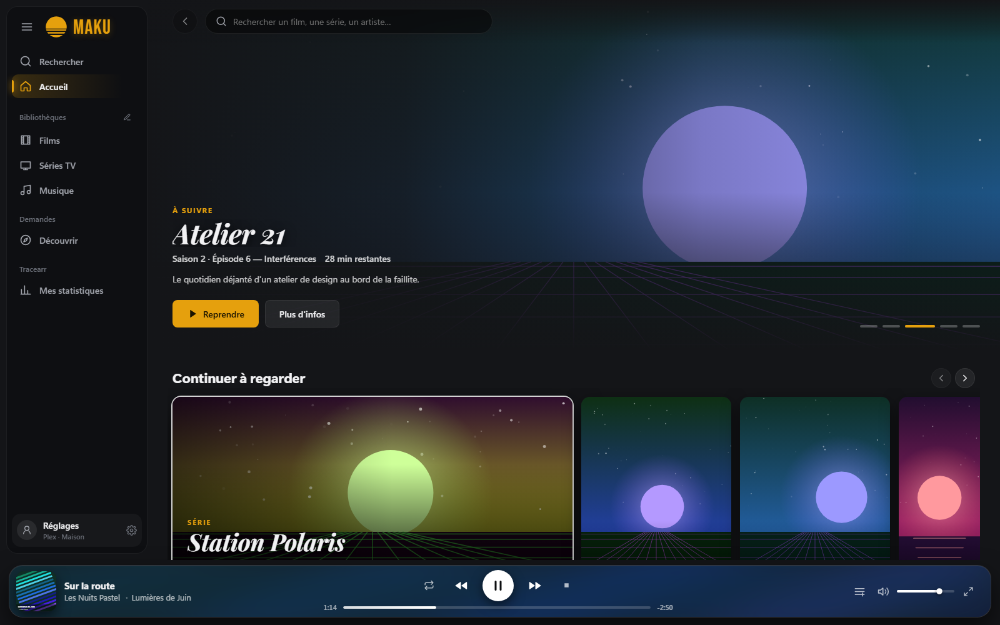
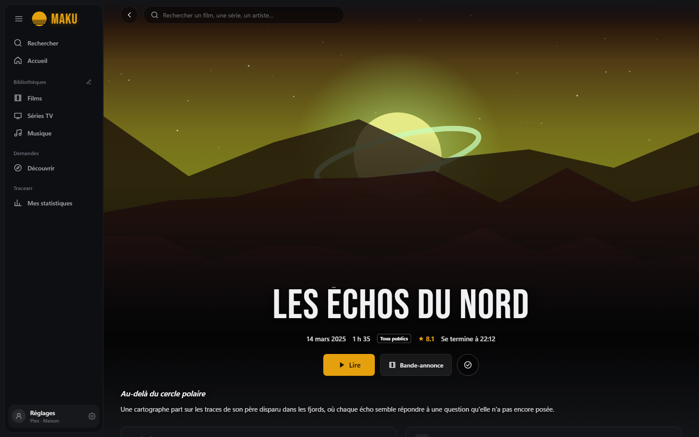
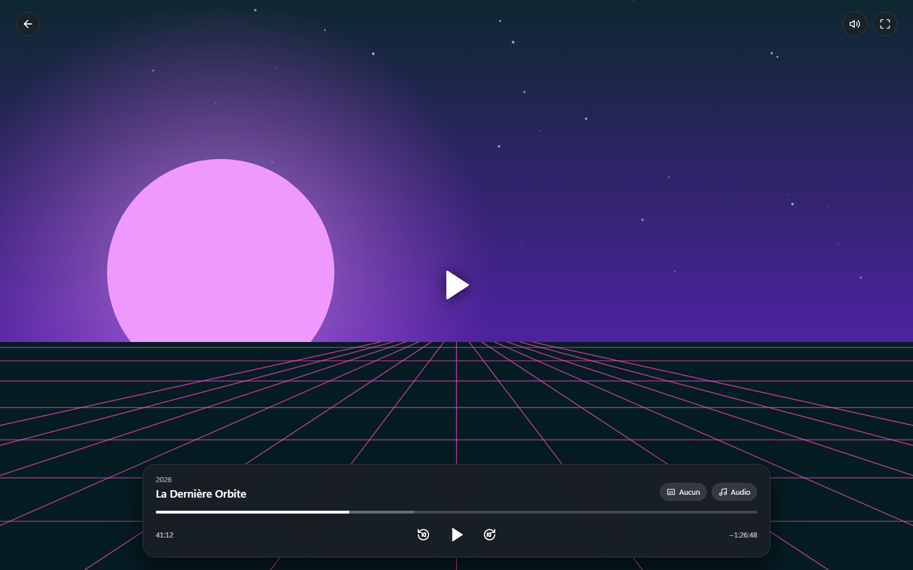
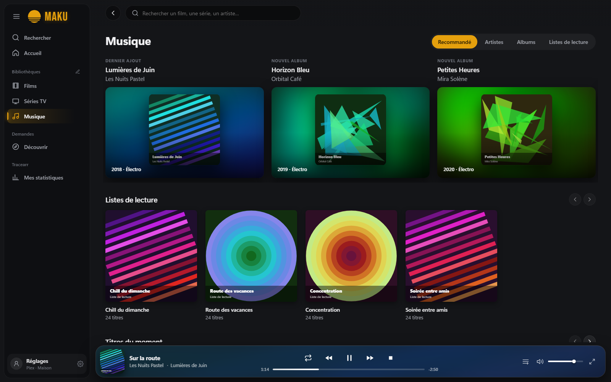
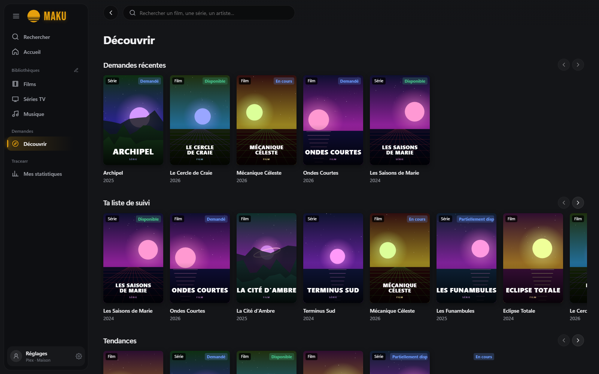
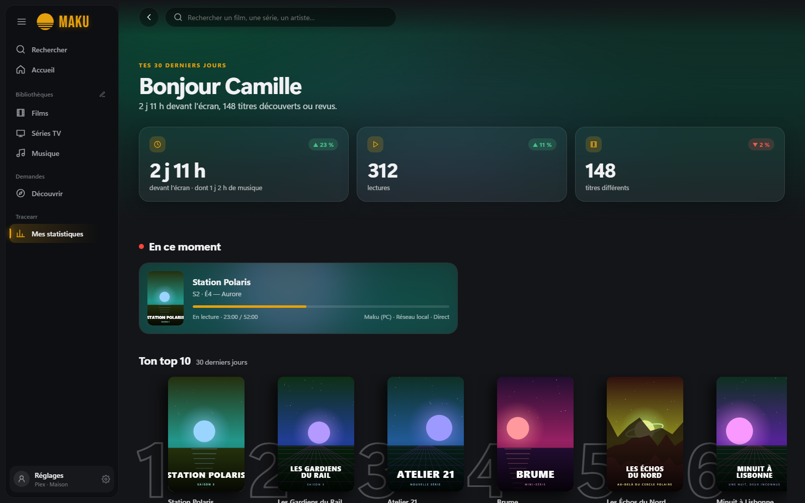
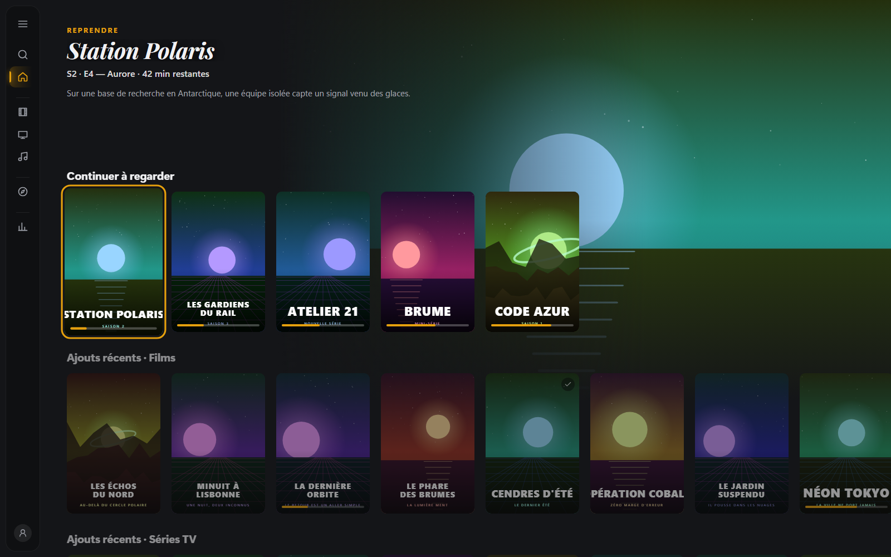

<p align="center">
  
</p>

<h3 align="center">Vos films, vos séries et votre musique Plex, Jellyfin ou Emby, dans une application rapide et soignée.</h3>

<p align="center">
  
  
  
  
  
  
  
  
  <a href="LICENSE"></a>
  <a href="https://ko-fi.com/yanutros"></a>
</p>

<p align="center">
  <a href="https://yanutros.github.io/maku/"><b>Site</b></a> ·
  <a href="https://yanutros.github.io/maku/installer.html">Installer</a> ·
  <a href="https://yanutros.github.io/maku/configurer.html">Configurer</a> ·
  <a href="https://yanutros.github.io/maku/faq.html">Questions fréquentes</a> ·
  <a href="#-développer">Développer</a> ·
  <a href="#-confidentialité">Confidentialité</a> ·
  <a href="#-signature-du-code">Code signing policy</a> ·
  <a href="#%EF%B8%8F-mentions-légales">Mentions légales</a> ·
  <a href="#-licence">Licence</a>
</p>

---

Maku (anciennement **Plexr**) est un client [Plex](https://www.plex.tv), [Jellyfin](https://jellyfin.org) et [Emby](https://emby.media)
pour ordinateur, téléphone, tablette et TV, écrit en Rust avec [Tauri](https://tauri.app). Son nom vient de 幕, « rideau » en
japonais : celui qui s'ouvre sur la séance ; son logo, un soleil couchant rayé, prend la couleur choisie dans l'interface.

Il a été pensé pour être **rapide et fluide** : la vidéo d'origine est décodée par l'appareil lui-même ([mpv](https://mpv.io)
sur ordinateur, le lecteur natif d'Android ailleurs), dans sa propre couche sous l'interface, sans attendre une conversion du
serveur ; le son Dolby, DTS ou Atmos part tel quel vers l'ampli ; l'interface TV est allégée pour les téléviseurs modestes.

Il réunit aussi deux outils que l'on utilise souvent à côté de son serveur : **Seerr**, pour demander un film ou une série
absent, et **Tracearr**, pour suivre ses statistiques. Tout se fait avec son compte Plex (ou Jellyfin) : aucune clé d'API à saisir.

> [!TIP]
> **Le mode d'emploi complet est sur le [site de Maku](https://yanutros.github.io/maku/)** : une page par fonctionnalité,
> le guide d'[installation](https://yanutros.github.io/maku/installer.html), celui de
> [configuration](https://yanutros.github.io/maku/configurer.html) (Plex, Jellyfin, Emby, Seerr, Tracearr, invitations,
> Maku Server) et les [questions fréquentes](https://yanutros.github.io/maku/faq.html).

## ✨ Ce que fait Maku

| | |
| --- | --- |
| 🎬 **[Le lecteur](https://yanutros.github.io/maku/lecture.html)** | 4K, HEVC et HDR sans conversion, pistes audio et sous-titres, aperçus sur la barre de progression, passer l'intro et le générique, épisode suivant, son vers l'ampli, lecture hors ligne sur Android |
| 🏠 **[Les bibliothèques](https://yanutros.github.io/maku/bibliotheques.html)** | accueil façon plateforme de streaming, fiches immersives (logos, notes IMDb, Rotten Tomatoes, TMDB, Allociné), catégories, collections, filtres, tri et bandeau des lettres |
| 🎵 **[La musique](https://yanutros.github.io/maku/musique.html)** | playlists, Mix of Three, paroles synchronisées, radio d'artiste, enchaînement sans blanc, Chromecast, AirPlay, musique en arrière-plan et Android Auto |
| 📥 **[Les demandes](https://yanutros.github.io/maku/demandes.html)** | tendances et sorties à venir via Seerr, fiche complète, demande d'un film ou de saisons en un clic |
| 📊 **[Les statistiques](https://yanutros.github.io/maku/statistiques.html)** | avec Tracearr : temps devant l'écran, top 10 du mois, genres préférés, plus longue série, plus gros marathon |
| 📺 **[TV, téléphone et voiture](https://yanutros.github.io/maku/appareils.html)** | une interface pour la télécommande, une autre pour le téléphone, la musique sur Android Auto, des mises à jour intégrées |
| 🛠️ **[Pour l'administrateur](https://yanutros.github.io/maku/administration.html)** | lectures en cours, débit, utilisateurs, réglages du serveur, demandes Seerr à valider, corriger ou refuser, fiches à modifier, association à corriger, collections intelligentes, invitations en QR code |

Maku parle français, anglais, espagnol, allemand et néerlandais, et prend la couleur de votre choix (jaune, rouge, vert ou violet) sur le fond de votre choix (nuit, graphite, ardoise, minuit ou marine).

## 📸 Aperçu

> [!NOTE]
> Ces captures viennent du **mode démo** de Maku : la bibliothèque est fictive et toutes les affiches sont
> générées par le programme. Aucun film, aucune série ni aucune œuvre réelle n'y figure.

<p align="center">
  
  <br /><em>L'accueil : bandeau « À suivre », rangées et barre de musique.</em>
</p>

<table>
  <tr>
    <td width="50%"><br /><em>📄 La fiche d'un film</em></td>
    <td width="50%"><br /><em>▶️ Le lecteur intégré</em></td>
  </tr>
  <tr>
    <td><br /><em>🎵 La musique</em></td>
    <td><br /><em>🧭 Découvrir avec Seerr</em></td>
  </tr>
  <tr>
    <td><br /><em>📊 Mes statistiques (Tracearr)</em></td>
    <td><br /><em>📺 Sur Android TV</em></td>
  </tr>
</table>

## 🚀 Installer

Les paquets de chaque version sont publiés dans les [Releases](../../releases). Maku est aussi sur le
[Microsoft Store](https://apps.microsoft.com/detail/9MZSQFBJL1X5) (Windows) et l'[Amazon Appstore](https://www.amazon.com/gp/product/B0HQWWD4DL)
(Fire TV) : c'est alors le magasin qui l'installe et le met à jour. Ailleurs, Maku se met à jour lui-même.

| Système | Fichier | Installation |
| --- | --- | --- |
| 🪟 **Windows** | `Maku_<version>_x64-setup.exe` (ou `.msi`) | lancez l'installeur : mpv est inclus (voir aussi [Signature du code](#-signature-du-code)) |
| 🎩 **Fedora / RHEL** | `Maku-<version>-1.x86_64.rpm` | `sudo dnf install ./Maku-*.rpm` (installe aussi mpv) |
| 🐧 **Debian / Ubuntu** | `Maku_<version>_amd64.deb` | `sudo apt install ./Maku_*.deb` (installe aussi mpv) |
| 📦 **Autres Linux** | `Maku_<version>_amd64.AppImage` | `chmod +x`, et mpv depuis votre gestionnaire de paquets |
| 🍎 **macOS** | `Maku_<version>_universal.dmg` | glissez Maku dans Applications, puis `brew install mpv` |
| 🤖 **Android (téléphone, tablette, TV)** | `Maku_<version>_android.apk` | à installer une fois à la main ; les versions suivantes s'installent depuis Maku |

Le [guide d'installation](https://yanutros.github.io/maku/installer.html) détaille chaque système : Microsoft Defender,
premier lancement sur macOS, FFmpeg sous Fedora, installation sur Android TV, mises à jour. Pas encore de Flatpak : il
demanderait d'embarquer mpv dans le bac à sable et de passer la relecture de Flathub.

## ⚙️ Configurer

Au premier lancement, choisissez **Plex** (connexion par code dans le navigateur, ou sur plex.tv/link depuis une TV),
**Jellyfin** ou **Emby** (adresse, identifiant et mot de passe, ou Quick Connect). Seerr et Tracearr s'ajoutent dans
**Réglages → Services**, à la main ou avec l'invitation en QR code de l'administrateur.

Tout est expliqué pas à pas dans le [guide de configuration](https://yanutros.github.io/maku/configurer.html).
L'administrateur qui ne veut pas exposer Seerr et Tracearr sur Internet installe le relais [Maku Server](server/README.md)
(image Docker `ghcr.io/yanutros/maku-server`, amd64 et arm64).

Avec Jellyfin 12, le [plugin Maku](plugins/jellyfin/) fait la même chose depuis Jellyfin lui-même, par l'adresse du
serveur, sans Docker ni port en plus ; Seerr s'y utilise sans mot de passe (dépôt à ajouter dans Jellyfin :
`https://github.com/yanutros/maku/releases/download/jellyfin-plugin/manifest.json`).

## 🛠️ Développer

```bash
npm install
npm run tauri dev
```

L'interface se recharge à chaque modification et le backend Rust est recompilé automatiquement.

**Mode démo.** `npx vite` puis `http://localhost:1420/?demo=accueil` lance l'interface dans un navigateur, sans
serveur, avec une bibliothèque fictive et des visuels générés. Vues disponibles : `accueil`, `films`,
`categories`, `series`, `serie`, `fiche`, `lecteur`, `decouvrir`, `seerr`, `musique`, `ecoute`, `stats`, `reglages`,
`reglages-interface`, `demandes-admin` (avec `&admin` : Admin › Demandes) et `vide` (l'accueil sans musique en cours). C'est ce mode qui produit les captures de cette page et du
site. `?device=phone` ou `?device=tv` imposent l'interface du téléphone ou du téléviseur dans le navigateur.

**Le site.** Il est dans [`docs/`](docs/) et publié par GitHub Pages : des pages HTML statiques (`index.html`, une page par
fonctionnalité, `installer.html`, `configurer.html`, `faq.html`) qui partagent [`docs/assets/site.css`](docs/assets/site.css).
Il se tient à jour avec l'application : chaque nouvelle fonctionnalité y a sa place, sans données personnelles.

**Tests de l'interface.** `npm test` ouvre Maku en mode démo avec [Playwright](https://playwright.dev) et le pilote
comme un utilisateur, sur quatre appareils simulés : ordinateur, téléviseur (flèches, OK, Retour), téléphone et
moteur de Safari (iPad, Mac). Les parcours (`tests/`) couvrent l'accueil, les fiches (série, saison, épisode),
les acteurs, le lecteur, le journal de diagnostic (un élément y est décrit sans son texte), la lecture (une lecture arrêtée ou remplacée pendant l'attente du serveur ne démarre pas,
le plein écran se quitte à la fermeture de la vidéo, une session Tracearr expirée ne recharge pas l'application en
boucle), les Réglages et la barre simplifiée. Pour jouer un serveur lent ou une erreur, un test retarde ou fait
échouer une commande de la démo (`window.__demoHooks`, voir `src/lib/demo.ts`). Ils vérifient des règles tirées des bugs déjà
corrigés (fond jusqu'au bord gauche, sélection entière à l'écran et de la couleur du thème, un seul acteur
sélectionné, lignes des Réglages sans saut, plus de cases à cocher, pas de barres de défilement sur TV…) et
comparent des captures à des images de référence (`tests/images/`). Après un changement voulu de l'affichage,
`npm run test:update` met ces images à jour. Les navigateurs s'installent une fois avec
`npx playwright install chromium webkit`. Sur GitHub, les tests passent à chaque envoi sur `main` et avant la
construction des paquets d'une version (les images de référence, prises sous Windows, n'y sont pas comparées).

**Tests du Rust.** Les règles qui ne dépendent ni d'un serveur ni d'un appareil ont leurs tests dans le code
(`#[cfg(test)]`) : commandes que l'interface peut envoyer à mpv, redirections suivies, jetons retirés des messages
d'erreur, écriture de la configuration, adresse d'un serveur Plex retenue seulement si c'est lui qui répond, relais
cherché en `https` d'abord, lecture arrêtée ou remplacée pendant sa préparation qui ne lance pas mpv, progression
abandonnée quand le serveur ne répond pas, aucun jeton sur la ligne de commande de mpv, seul mpv accepté comme
lecteur, pochette publiée au bureau sans l'adresse du serveur… `cargo test` dans `src-tauri` les lance (après `npm install`, la page du téléphone
intégrant jsQR). Sur GitHub, ils passent à chaque envoi sur `main` et avant la construction des paquets d'une
version, comme ceux de Maku Server (`cargo test` dans `server`).

**Tests du lecteur Android.** Les règles du lecteur vidéo natif sont à part, dans `PlaybackRules.kt` : vidéo
figée (prête, en lecture, avec de l'avance, mais immobile 5 s ; reprise ou saut ensuite), son envoyé tel quel à
l'ampli, format de l'image à l'écran, type des sous-titres externes, erreurs qui demandent la conversion,
numérotation des pistes et mémoire des formats de l'ampli au démarrage de la TV. S'y ajoutent les commandes
acceptées par le service de musique (`MediaActions`) : lecture, pause, suivant, précédent, arrêt et position, rien
d'autre, même envoyé par une autre application ; les applications qui peuvent y faire jouer la bibliothèque ; ce que
la page peut demander à l'appareil (`BridgeRules` : nom d'une image partagée, APK à installer) ; et ce que le journal
de diagnostic retire de chaque ligne (`DiagClean`). Des tests ordinaires
(`src-tauri/gen/android/app/src/test/`) les vérifient sans appareil : dans `src-tauri/gen/android`,
`./gradlew :app:testUniversalDebugUnitTest`, après une première construction de l'APK (Tauri y génère des
fichiers du projet). Sur GitHub, ils passent à chaque envoi sur `main`, après la construction de l'APK.

**iPad (essai).** Une app iPad se compile seulement sur un Mac : la construction « iPad (essai) » de l'onglet
Actions la produit sur un Mac de GitHub, sans signature (`Maku-ipad.ipa`, joint à l'exécution). Un outil comme
Sideloadly la signe avec un compte Apple en l'installant ; avec un compte gratuit, elle est à réinstaller tous les
7 jours. Les vidéos y passent par le flux converti du serveur, que l'iPad lit nativement ; la qualité et les
pistes audio et sous-titres se changent pendant la lecture. L'icône de l'app vient de `src-tauri/icons/ios.png`, un
carré plein qu'iPadOS arrondit lui-même (voir `docs/logo-ios.html`).

### Compiler soi-même

Il faut [Rust](https://rustup.rs) et [Node.js](https://nodejs.org), plus :

- **Windows** : les [Visual Studio Build Tools](https://visualstudio.microsoft.com/fr/visual-cpp-build-tools/)
  (charge de travail « Développement Desktop en C++ ») ;
- **Fedora** : `sudo dnf install webkit2gtk4.1-devel openssl-devel librsvg2-devel` et le groupe
  `sudo dnf group install c-development` ;
- **Debian / Ubuntu** : `sudo apt install libwebkit2gtk-4.1-dev build-essential librsvg2-dev libssl-dev` ;
- **macOS** : les outils en ligne de commande Xcode (`xcode-select --install`).

```bash
git clone https://github.com/yanutros/maku.git
cd maku
npm install
npm run tauri build
```

Les paquets sont créés dans `src-tauri/target/release/bundle/` (sous-dossiers `nsis`, `msi`, `rpm`, `deb`,
`appimage` ou `dmg` selon le système).

Sous Windows, `scripts/fetch-mpv.mjs` télécharge d'abord une version épinglée de mpv
([mpv-winbuild-cmake](https://github.com/shinchiro/mpv-winbuild-cmake)), vérifiée par son empreinte SHA-256,
dans `src-tauri/mpv-win/` (ignoré par git) : l'installeur la dépose dans `Maku\mpv\`, où Maku la trouve. Un
chemin de mpv indiqué dans **Réglages → Lecteur** reste prioritaire.

**Android.** Il faut en plus le JDK 17, le SDK Android (plateforme 37, build-tools, platform-tools) et le NDK,
avec les variables `JAVA_HOME`, `ANDROID_HOME` et `NDK_HOME`, ainsi que les cibles Rust
(`rustup target add aarch64-linux-android armv7-linux-androideabi`). Sous Windows, le **mode développeur** doit
être activé (Tauri crée des liens symboliques). Le projet Android est versionné dans `src-tauri/gen/android`.

```bash
npx tauri android build --apk --target aarch64 --target armv7
```

L'APK universel est créé dans `src-tauri/gen/android/app/build/outputs/apk/universal/release/`. Pour le signer,
placez un fichier `src-tauri/gen/android/keystore.properties` (ignoré par git) contenant `storeFile`,
`password` et `keyAlias` ; sans lui, l'APK n'est pas signé et Android refuse de l'installer.

Sur GitHub, [`.github/workflows/android.yml`](.github/workflows/android.yml) construit le même APK à chaque envoi
sur `main` (et pour chaque demande de fusion), sauf quand seuls le README ou le site (`docs/`) changent : un problème de compilation Android (Rust, Kotlin, SDK, licences)
se voit tout de suite, et non le jour d'une version. Faute de clé, cet APK n'est pas signé : il est joint à
l'exécution pour vérification, pas pour être installé. Les tests du lecteur natif y passent ensuite (voir
« Tests du lecteur Android » plus haut).

### Publier une version

Le workflow [`.github/workflows/paquets.yml`](.github/workflows/paquets.yml) construit les paquets des trois
systèmes sur GitHub Actions et les joint à une version en brouillon. Il se lance en poussant une étiquette
(`git tag v0.2.0 && git push origin v0.2.0`, après avoir mis à jour la version dans `package.json`,
`src-tauri/Cargo.toml` et `src-tauri/tauri.conf.json`, ainsi que `server/Cargo.toml`) ou à la main depuis l'onglet
**Actions**. La même étiquette publie l'image Docker de Maku Server ([`.github/workflows/serveur.yml`](.github/workflows/serveur.yml)).

Sous Windows, `plexr.exe` est signé avant d'être empaqueté, puis l'installeur NSIS et le MSI le sont à leur tour,
par [SignPath](https://signpath.io) : le workflow attend que chacune des deux demandes de signature soit approuvée
dans SignPath (voir [Signature du code](#-signature-du-code)). Il lui faut le secret `SIGNPATH_API_TOKEN` et les
variables de dépôt `SIGNPATH_ORGANIZATION_ID`, `SIGNPATH_PROJECT_SLUG` et `SIGNPATH_POLICY_SLUG` ; les
configurations d'artefact à déclarer dans SignPath (`exe` et `installeurs`) sont dans
[`.signpath/artifact-configurations/`](.signpath/artifact-configurations). Sans ces variables, les paquets
Windows sont construits sans signature.

Le même job construit aussi le paquet MSIX du Microsoft Store ([`scripts/build-msix.ps1`](scripts/build-msix.ps1),
manifeste dans [`src-tauri/msix/`](src-tauri/msix/AppxManifest.xml)) et le joint à l'exécution, et non à la version :
non signé, il ne s'installerait pas. Il s'envoie depuis l'Espace partenaires, où le Store le signe. Le script y
ajoute les icônes « sans plaque » de la barre des tâches (toutes les tailles, thèmes sombre et clair) et leur index
`resources.pri` : sans elles, Windows pose l'icône réduite sur une plaque de couleur. Il refuse d'emballer un `plexr.exe` qui ne serait
pas à la version du projet (compilation précédente restée dans `target/release`).

L'APK Android est compilé et signé sur l'ordinateur du mainteneur (la clé de signature ne quitte pas sa
machine), puis ajouté à la version avec `gh release upload`.

La version Google Play est un `.aab` construit par [`scripts/build-play.ps1`](scripts/build-play.ps1), signé avec la
même clé (clé d'importation ; Google signe ensuite l'app). Google Play interdit qu'une app se mette à jour seule :
elle est construite avec `MAKU_PLAY` (mise à jour intégrée désactivée) et sans la permission
`REQUEST_INSTALL_PACKAGES`. Comme celle du Microsoft Store, elle n'affiche pas non plus le lien de dons Ko-fi, que les
règles des magasins n'autorisent pas.

### 🌍 Traductions

Les textes sont dans des fichiers JSON au format **i18next** (le même que [Tracearr](https://github.com/connorgallopo/Tracearr),
compatible Crowdin), un par langue :

- `src/locales/<langue>.json` : l'interface ;
- `src-tauri/locales/<langue>.json` : les messages du backend et la page du téléphone (invitations).

Clés imbriquées, variables `{{nom}}`, pluriels en `_one` / `_other` ; une clé absente se rabat sur l'anglais,
puis le français. Dans le code : `t("settings.interface.color")` côté interface (`src/lib/i18n.ts`),
`tr("seerr.unreachable")` côté Rust (`src-tauri/src/i18n.rs`).

**Ajouter une langue** : copiez `en.json` dans les deux dossiers sous le code de la langue (`it.json`…),
traduisez les valeurs sans toucher aux clés ni aux `{{variables}}`, puis déclarez-la dans `LANGUAGES`
(`src/lib/i18n.ts`) et `LOCALES` (`src-tauri/src/i18n.rs`). Les propositions de traduction sont les bienvenues.

### 🏗️ Architecture

| Fichier | Rôle |
| --- | --- |
| `src-tauri/src/plex.rs` | plex.tv (PIN, serveurs) et API du serveur Plex : bibliothèques, rangées, genres, musique |
| `src-tauri/src/player.rs` | mpv incrusté dans la fenêtre (`--wid`, sous la page web transparente) ou en audio seul, piloté par son IPC JSON ; la progression part vers le serveur à côté du suivi de mpv, pour qu'un serveur lent ne gèle ni la barre de lecture ni les commandes |
| `src-tauri/src/seerr.rs` | Seerr : connexion Plex ou Jellyfin, découverte, fiches détaillées, demandes, et leur gestion par l'administrateur (liste, validation, modification, suppression) |
| `src-tauri/src/tracearr.rs` | Tracearr : connexion Plex et tableau de bord personnel |
| `src-tauri/src/maku_server.rs` | relais Maku Server : recherche sur la machine du serveur, vérification (`/maku/info`) et jeton joint aux appels |
| `plugins/jellyfin/` | plugin Maku pour Jellyfin 12 (C#, .NET 10) : relais de Seerr (clé d'API, au nom du compte Seerr de chaque utilisateur, retrouvé par son identifiant Jellyfin ou lié à la main ; jeton CSRF de Seerr géré) et de Tracearr (cookies de session) à l'adresse du serveur (`/Maku/…`), `/Maku/maku/info` pour que Maku le reconnaisse, page de réglages ; tests xUnit des règles du relais. Compilé par `.github/workflows/plugin-jellyfin.yml` ; un tag `jellyfin-v1.2.3` publie le catalogue Jellyfin (version GitHub `jellyfin-plugin`), construit par `plugins/jellyfin/catalogue.mjs` : les versions précédentes y sont gardées, et un ancien catalogue introuvable ou illisible arrête la publication au lieu d'être remplacé (`node --test plugins/jellyfin/catalogue.test.mjs`) |
| `server/` | Maku Server, le relais lui-même (Rust, axum) : vérification du jeton auprès de Plex, Jellyfin ou Emby, transmission de l'API de Seerr et de Tracearr ; image Docker |
| `src-tauri/src/plex_admin.rs`, `src/components/FixMatchDialog.svelte` | administration : édition des métadonnées, images, association d'un film ou d'une série (« Corriger l'association » : titres proposés par l'agent de Plex ou recherche par titre et année ; « Dissocier »), réglages et lectures du serveur |
| `src-tauri/src/net.rs` | règles de redirection des clients HTTP : même machine pour les serveurs, domaines GitHub pour les mises à jour ; jetons retirés des messages d'erreur (`redact`, appliqué à toute erreur rendue à l'interface) |
| `src-tauri/src/update.rs` | dernière version sur GitHub, paquet adapté à l'appareil, téléchargement et installation |
| `src-tauri/src/relay.rs`, `relay.html`, `relay-login.html`, `relay-tmdb.html` | relais du téléphone : petite page servie sur le réseau local, pour l'invitation (lecture du QR code avec jsQR), la clé TMDB ou la connexion Jellyfin / Emby d'un téléviseur |
| `src-tauri/src/lib.rs`, `src-tauri/src/commands/` | état de l'application et démarrage (`lib.rs`) ; commandes Tauri rangées par domaine : comptes, bibliothèques, actions sur un titre, lecture, Chromecast, téléchargements, Seerr, Tracearr, administration… |
| `src-tauri/src/media.rs` | couche commune aux serveurs : Plex (`plex.rs`) ou Jellyfin et Emby (`jellyfin.rs`), vus de la même façon par l'interface |
| `src/views/` | pages : accueil, bibliothèques, fiches, musique, découverte, statistiques, réglages ; les rubriques des réglages sont dans `src/views/settings/` (styles communs dans `settings.css`), les panneaux, épisodes et distribution d'une fiche dans `src/views/item/` |
| `src/components/` | bandeau, cartes, lecteur vidéo, barre de musique… |
| `src/lib/demo.ts` | mode démo (bibliothèque fictive) |
| `src/components/TitleLogo.svelte`, `src/lib/logos.ts` | logos des titres : serveur, service en ligne de Plex, sinon titre stylisé selon le genre |
| `src/lib/i18n.ts`, `src/locales/`, `src-tauri/src/i18n.rs`, `src-tauri/locales/` | traductions (voir ci-dessus) |
| `src/lib/theme.ts`, `src-tauri/icons/themes/` | couleurs de l'interface et icônes assorties, fonds au choix (`data-background`, nuances dans `src/app.css`) ; `docs/logo.html?theme=…` et `docs/tv-banner.html?theme=…` les produisent |
| `src/lib/prefs.ts` | préférences de l'interface (`plexr.*`, `maku.*` du stockage du navigateur) recopiées dans `config.json` (`ui`) et remises au démarrage, avant le chargement des modules qui les lisent : elles survivent à un stockage vidé ou non écrit à temps |
| `src/components/UpdateDialog.svelte`, `src/lib/markdown.ts` | fenêtre « Nouvelle version disponible » et mise en forme des nouveautés ; `src/lib/update.svelte.ts` n'en garde que les sections Nouveautés / Corrections (ou What's new en anglais), sans les paquets |
| `src/lib/invite.ts`, `src/components/QrCode.svelte` | codes d'invitation, QR codes (qrcode-generator) et lecture d'images (jsQR) |
| `src/lib/device.ts` | type d'appareil (ordinateur, tablette tactile, téléviseur) et échelle de l'interface sur TV |
| `src/lib/spatial.ts`, `src/lib/nav.svelte.ts` | navigation à la télécommande (flèches) et bouton Retour d'Android |
| `src/components/TvRows.svelte`, `TvGrid.svelte`, `src/lib/tvcards.ts` | interface TV : rangées avec fiche en haut, grilles légères ; menu d'un titre à l'appui long (`TvMenu.svelte`, `src/lib/longpress.ts`), choix des pistes sous le champ (`TrackSelect.svelte`) |
| `src-tauri/src/offline.rs`, `src/lib/offline.svelte.ts`, `src/views/Downloads.svelte` | lecture hors ligne : file de téléchargements (fichier d'origine repris par `Range`, ou version convertie récupérée morceau par morceau en HLS et mise bout à bout), page Téléchargements, progression renvoyée au serveur |
| `src-tauri/src/plex_users.rs`, `src/components/ServerUsers.svelte` | utilisateurs du serveur Plex (administrateur) : comptes partagés, bibliothèques, autorisations et restrictions, invitation et retrait, via plex.tv |
| `src-tauri/src/cast.rs`, `src/components/CastButton.svelte` | Chromecast : appareils trouvés par mDNS, protocole Cast v2 (TLS, messages protobuf), file confiée au lecteur de Google et pilotée ; AirPlay sur iOS |
| `src/lib/player.svelte.ts`, `src/lib/player/` | lecture : mpv sur ordinateur, ExoPlayer natif sur Android (décodeur audio FFmpeg, son transmis à l'ampli ; en secours, flux du serveur qui ne convertit que le son, puis tout). L'état du lecteur (`state.svelte.ts`), le pont Android (`bridge.ts`), Chromecast (`cast.svelte.ts`) et la notification (`notification.svelte.ts`) sont à part ; `player.svelte.ts` les réexporte |
| `src-tauri/gen/android/` | projet Android : manifeste (Android TV, bannière, icônes par couleur), signature, détection du téléviseur et du téléphone, barres système, vidéo en paysage (`MainActivity.kt`), lecteur vidéo natif sous la page (`NativeVideo.kt`, ses règles testées dans `PlaybackRules.kt`), journal de diagnostic (`DiagLog.kt`), musique en arrière-plan, notification et Android Auto (`MediaService.kt`, bibliothèque lue auprès de Plex dans `PlexLibrary.kt`, pochettes servies à la voiture par `ArtProvider.kt`) |
| `src/components/PhoneTabs.svelte`, `src/views/Libraries.svelte` | téléphone : barre d'onglets et liste des bibliothèques |
| `src/components/SeerrRequests.svelte`, `src/components/RequestEditDialog.svelte`, `src/lib/seerrAdmin.svelte.ts` | Admin › Demandes, pour l'administrateur de Seerr (droit ADMIN ou MANAGE_REQUESTS, lu dans `/auth/me`), sauf au téléviseur : demandes de tous les utilisateurs par état, valider, refuser, relancer, supprimer, et changer serveur, profil et dossier d'une demande en attente (`/service/radarr`, `/service/sonarr`) ; pastille des demandes en attente dans le menu |
| `src/components/Toasts.svelte`, `src/components/ErrorCard.svelte`, `notify` et `toast` (`src/lib/nav.svelte.ts`) | notifications en cartes empilées (trois au plus) : icône selon le type (succès, erreur, information), titre, explication, geste (« Réessayer ») et détails techniques repliés ; `describeError` tire d'un message d'erreur un titre lisible ; sur TV, ni bouton ni croix. Les erreurs dans les pages et les formulaires prennent la même carte (`ErrorCard`), à leur place, avec « Réessayer » qui recharge la page (`reloadView`) ou le bloc ; styles communs `.notice` dans `src/app.css` |
| `src-tauri/tauri.conf.json`, `tauri.windows.conf.json` | configuration et paquets ; la fenêtre transparente n'est activée que sous Windows |
| `.github/workflows/paquets.yml`, `.signpath/` | construction des paquets Windows, Linux et macOS, signature des paquets Windows par SignPath (l'APK est construit à part ; `android.yml` vérifie qu'il se construit à chaque envoi) |
| `docs/` | le site (GitHub Pages) : accueil, pages des fonctionnalités, guide et questions fréquentes, styles dans `docs/assets/site.css`, captures dans `docs/screenshots/` |

Sous Windows, pendant une vidéo, la fenêtre Tauri devient transparente et mpv dessine l'image dessous : l'interface
web n'affiche plus que la barre de contrôle par-dessus. Ailleurs, mpv ouvre sa propre fenêtre et Maku devient une
télécommande, reliée à mpv par son IPC (socket Unix).

mpv ne survit jamais à Maku : il est arrêté quand l'application se ferme et, sous Windows, rattaché à
Maku par un « Job Object » qui le fait fermer par le système même si Maku plante ou est tué.

## 🔒 Confidentialité

La politique de confidentialité complète, en français et en anglais, est dans [PRIVACY.md](PRIVACY.md).

- Maku parle directement à votre serveur de médias, à plex.tv (connexion), à l'API publique de GitHub (pour savoir
  si une nouvelle version existe) et, si vous les configurez, à Seerr, Tracearr et TMDB. Il n'envoie rien ailleurs
  et ne collecte aucune statistique d'usage.
- Il cherche Maku Server sur la machine de votre serveur (port 32700, en `https` d'abord), et ne lui confie votre
  jeton qu'après avoir vérifié qu'il est le relais de ce serveur-là.
- Avec Plex, les adresses du serveur sont essayées sans jeton, et une adresse n'est retenue que si le serveur qui y
  répond est le vôtre : sur un autre réseau, la machine qui occupe la même adresse locale ne reçoit rien. Une adresse
  Jellyfin ou Emby saisie sans `http://` ni `https://` est essayée en `https` d'abord.
- Pendant la configuration par téléphone, et seulement tant que l'écran est ouvert, Maku écoute sur le réseau
  local à une adresse aléatoire, qui n'accepte qu'un code d'invitation.
- La configuration est stockée sur votre appareil : `%APPDATA%\io.github.yanutros.plexr\config.json` sous Windows,
  `~/.config/io.github.yanutros.plexr/config.json` sous Linux, `~/Library/Application Support/io.github.yanutros.plexr/config.json`
  sous macOS, dans les données privées de l'application sur Android. Elle contient
  le jeton Plex et les cookies de session Tracearr **en clair** : ne la partagez pas (sous Linux et macOS, elle n'est
  lisible que par votre compte). Elle est écrite d'un seul geste, sans jamais rester à moitié écrite ; un fichier
  devenu illisible est gardé à côté (`config.json.bad`) au lieu d'être perdu.
- Les messages d'erreur affichés, copiés ou gardés avec un téléchargement ne contiennent pas vos jetons : les
  paramètres des adresses en sont retirés.
- Un serveur ne peut rediriger Maku que vers lui-même (de `http` vers `https`, par exemple) : jamais vers une autre
  adresse, où partiraient ses jetons. Seul le téléchargement des mises à jour suit les redirections de GitHub vers son stockage.
- L'interface ne transmet à mpv que des commandes de lecture (pause, position, volume, pistes, file d'attente) ;
  celles qui lancent un programme ou écrivent un fichier sont refusées. Le chemin de mpv indiqué dans les Réglages
  doit désigner mpv : Maku n'enregistre et ne lance aucun autre programme.
- Les adresses que mpv lit portent le jeton de votre serveur : elles lui sont données dans des fichiers temporaires
  lisibles par votre seul compte, supprimés à la fin de la lecture, et non sur sa ligne de commande.
- Sous Linux, la pochette publiée au bureau (MPRIS) est une copie locale de l'image, pas l'adresse de votre serveur.
- Sur Android, le journal de diagnostic reste sur l'appareil tant que vous ne l'envoyez pas vous-même. Les adresses
  de serveur, adresses IP, jetons, identifiants et chemins de fichiers en sont retirés avant l'écriture, et il ne
  note ni titre de votre bibliothèque ni nom de profil ; il ne pèse pas plus de 600 Ko.
- Sur Android, l'installateur du système ne reçoit de Maku qu'une mise à jour qu'il a lui-même téléchargée, et seules
  les applications reconnues (Android Auto, l'Assistant, le système) peuvent faire jouer votre bibliothèque par le
  service de musique ; les autres n'ont que les commandes de la lecture en cours, comme un casque.

## 🔏 Signature du code

Les installeurs Windows publiés sur GitHub ne sont pas signés : SignPath Foundation, qui signe gratuitement des
projets libres, a jugé Maku encore trop jeune. Windows et son antivirus peuvent donc traiter une nouvelle version
comme un programme inconnu, parfois à tort comme un logiciel malveillant (Microsoft Defender l'a déjà fait).

La version du **Microsoft Store**, [« Maku Player »](https://apps.microsoft.com/detail/9MZSQFBJL1X5), règle la question : le Store vérifie le paquet puis le signe
avec le certificat de Microsoft. Le paquet (MSIX) est construit à partir du même code, par
GitHub Actions ; sa fiche est décrite dans [docs/store.md](docs/store.md). mpv, inclus dans les deux, est un
programme tiers qui n'est pas signé par Maku.

Le workflow reste prêt pour une signature par SignPath, pour le jour où le projet sera accepté :

| Rôle | Membres |
| --- | --- |
| Auteurs (modifient le code) | [yanutros](https://github.com/yanutros) |
| Relecteurs (relisent toute contribution extérieure) | [yanutros](https://github.com/yanutros) |
| Approbateurs (approuvent chaque signature) | [yanutros](https://github.com/yanutros) |

Confidentialité : voir [Confidentialité](#-confidentialité) ci-dessus. Maku ne communique qu'avec les services que
l'utilisateur utilise ou configure (serveur Plex, Jellyfin ou Emby, plex.tv, Seerr, Tracearr, TMDB, YouTube pour les
bandes-annonces qu'il ouvre) et avec l'API publique de GitHub pour les mises à jour.

## ⚖️ Mentions légales

Maku est un projet indépendant, **sans lien avec Plex, Inc.**, ni avec les projets Seerr, Overseerr, Jellyseerr,
Tracearr ou mpv. « Plex » est une marque de Plex, Inc. ; les autres noms appartiennent à leurs propriétaires
respectifs. Maku ne fournit aucun contenu : il se contente d'afficher et de lire la bibliothèque de votre propre
serveur. Les visuels du mode démo et des captures ci-dessus sont générés par le programme.

## ☕ Soutenir Maku

Maku est gratuit et libre, développé sur le temps libre. Si l'application vous plaît, vous pouvez offrir un café
sur [Ko-fi](https://ko-fi.com/yanutros) : ça aide à le faire vivre (et à payer le compte développeur du Play Store).
Le lien est aussi dans l'application, **Réglages → Compte**.

<p align="center"><a href="https://ko-fi.com/yanutros"></a></p>

## 📜 Licence

Maku est un logiciel libre, distribué sous la licence **GNU GPL version 3 ou ultérieure** : voir le fichier
[`LICENSE`](LICENSE).

En résumé, chacun peut utiliser, étudier, modifier et redistribuer Maku, y compris dans une version modifiée,
à condition de la distribuer elle aussi sous GPL, avec son code source et en conservant les mentions de droits
d'auteur. Maku est fourni **sans aucune garantie**.

Les bibliothèques utilisées gardent leur propre licence (Tauri, Svelte et qrcode-generator sous MIT, jsQR et
hls.js sous Apache-2.0, les polices Bebas Neue, Cinzel, Orbitron, Fredoka, Playfair Display et Creepster sous
SIL Open Font License via Fontsource, notamment ; le logo Jellyfin de l'écran de connexion sous CC BY-SA 4.0,
projet Jellyfin) ; Plex est une marque de Plex, Inc. et Emby une marque d'Emby LLC : leur nom désigne seulement le service, leur logo n'est pas utilisé ; mpv est un
programme séparé, lancé par Maku, et reste sous sa licence. L'installeur Windows en inclut une version
compilée par [mpv-winbuild-cmake](https://github.com/shinchiro/mpv-winbuild-cmake), sous GPL, dont le code source
est disponible sur [github.com/mpv-player/mpv](https://github.com/mpv-player/mpv).
